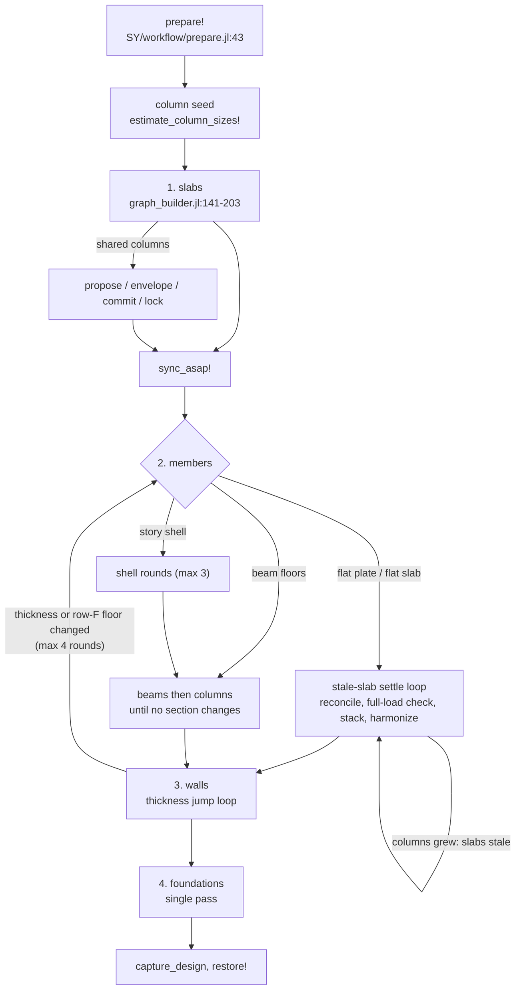

# Sizing map: stages, loops, decision space

A map of how `design_building` sizes a building: the stage order, every
iterative loop, the design variables of each element, and how elements feed
each other's checks. Use it to find where a size is decided before reading
code, and to judge whether a change can move final sizes.

Target design: [`architecture.md`](architecture.md) (where sizing is headed).
Roadmap: [`plan.md`](plan.md).

Detail lives in four raw reports (one record per loop, file:line cited):

| Report | Covers |
|---|---|
| [`raw/building-pipeline.md`](raw/building-pipeline.md) | Stage table (reads/writes), 11 feedback edges, loops L0–L16, flowchart |
| [`raw/slabs.md`](raw/slabs.md) | Every slab type; flat-plate phases A/B/C, thickness jump, joint search, FEA cache |
| [`raw/members.md`](raw/members.md) | Columns and beams: catalogs, objectives, checks, grouping, MIP, story shell, row-F floors |
| [`raw/walls-lateral-foundations.md`](raw/walls-lateral-foundations.md) | Wall thickness, drift/P-Δ, row F, foundation grouping, spread/strip/mat |

Line numbers are from the working tree on 2026-11-11. Paths: `SS/` =
`StructuralSizer/src/`, `SY/` = `StructuralSynthesizer/src/`.

---

## 1. Stage graph

The pipeline runs once, in this order. There is no outer whole-building loop:
slabs are never re-sized after walls change, and foundations never feed back.

## 2. How elements feed each other

Which variables of one element enter the checks of another. These edges are
where a local sizing decision becomes a building-level one.

| Variable | Set by | Read by | Effect |
|---|---|---|---|
| Column c1, c2 | seed, slab loop, member stage | slab punching (b0), clear span ln = l1 − c1, EFM stiffness, FEA mesh key, foundation punching | Bigger column: easier slab, more column carbon, more moment attracted |
| Slab h | slab loop | cell self weight, column Pu, beam loads, seismic W, wall out-of-plane moment | Thicker slab: heavier everything below |
| Beam stiffness | beam sizing | two-way slab αfm (**not wired**), story-shell demands, column moments | See sign-off item 2 |
| Column section | member stage | frame stiffness, column above/below (stacking) | Stacking forces lower ≥ upper in both dims |
| Wall thickness | wall loop | lateral stiffness, row-F frame floors, member re-size, footing width | Thickening re-runs the whole member stage |
| Frame forces | `sync_asap!` | member demands, foundation reactions | Forces from an earlier, heavier state can persist |

## 3. Decision space by element

| Element | Variables | Candidates | Objective | Loop style |
|---|---|---|---|---|
| Flat plate / flat slab | h, column c1×c2, studs, strip bars; drop depth fixed at ACI min | h on 0.5" grid to ln/10; columns 0.5" steps or RC catalog | Greedy first-pass (default `:grow_columns`), or min carbon (`:joint_search`) | Iterative, grow-only |
| Two-way with beams | h | ACI 318-11 §9.5.3.3 bound | none | Closed form, single pass |
| One-way | h | ACI table by thickest support condition | none | Closed form |
| Waffle | form depth; solid-head size | {8…24}" forms; whole rib modules | none | Table pick; head growth loop |
| Composite deck | depth × gage | tabulated | min self weight | Exhaustive |
| Vault | rise, thickness | grid / bisection | volume | Grid or bisection |
| RC columns | catalog section or (b, h, ρg) NLP | `rc_column_catalog` 8–36" | gross Ag only (**rebar not counted**) | MIP per pass |
| Steel columns/beams | W/HSS section (+ studs) | AISC catalog | weight / carbon | MIP per pass |
| RC beams | b, h, bars | `rc_beam_catalog` | gross b·h only | MIP per pass |
| Ordinary walls | t per group, ρt, ρl | 1" steps; ρ 0.0005 steps | thinnest passing | Grow-only jump loop |
| Spread footings | B (= L, square), h | 3" plan, 1" depth | smallest B then h | Closed form + bisection |
| Strip / mat footings | L, B, h; mat overhang, h | 3" / 1" steps | first passing | Grow-only loops |
| Timber, hollow core, PT, piles | — | — | — | Not implemented (throws) |

## 4. Ranked: loops that change final sizes

Ranked by how much they can make final sizes larger than needed. "Checked"
means the claim was checked against the code while assembling this map;
the rest are the raw reports' reading-level findings.

| # | Loop / rule | Mechanism | Fix direction | Checked |
|---|---|---|---|---|
| 1 | **Columns never shrink, from a conservative seed** | Seed ≥ building-average span/15 and ≥ axial at ρg = 0.01 over all floors above (`SY/analyze/members/members/size_columns.jl:517-597`). Every later step is `max(old, new)`. `start = :axial` is used only when `column_span_minimum = false` (`SY/workflow/prepare.jl:97-101`) | Seed from the column's own demand; final shrink-and-verify pass | yes |
| 2 | **Two-way slab with beams uses the "beams unknown" thickness bound** | `alpha_fm = nothing` gives max(Table 9.5(c) exterior, 1.1·Eq. 9-12 at αfm = 0.2, 5") (`SS/slabs/codes/concrete/min_thickness.jl:198-203`). No production caller passes `alpha_fm`. ~35% thicker than Eq. 9-13 for stiff beams | Size beams, compute αfm, re-check h, re-size beams | yes |
| 3 | **Flat-plate stale-slab loop** | Column growth (axial, full-load P-M, stacking, harmonize) marks slabs stale; redesign can grow columns again; nothing undone (`SY/workflow/graph_builder.jl:373-409`) | Joint slab/column search at building level; size axial before slabs | — |
| 4 | **Flat-plate default punching is greedy** | `:grow_columns` grows columns before considering h or studs; columns grown at a thin h are kept when h rises (`SS/slabs/.../punching_resolution.jl:129-138`, `column_updates.jl:108-109`) | `:joint_search` (built); reset columns on h restart | — |
| 5 | **Full-load column check must cover the current footprint** | Picks lightest catalog section ≥ current c1 and c2; never trades footprint for steel (`SY/workflow/flat_plate_column_check.jl:461-473, 635-640`) | Choose among sections ≥ the *required* footprint | — |
| 6 | **Uniform wall drift fix** | Worst story/direction drift ratio scales every wall group; default grouping `:all` means any pier failure thickens all walls (`SY/analyze/lateral/wall_thickness_jump.jl:333-341, 486-495`) | Per-direction, per-group drift sensitivity (`SS/walls/lateral/sensitivity.jl` exists, unused) | — |
| 7 | **Mat reinforcement** | Beam coefficients instead of strip statics; faces look swapped; single span uses wL²/2 (`SS/foundations/codes/aci/mat_footing.jl:447-469, 823-830`). Can be both over- and under-sized; see sign-off item 5 | Rigid strip statics per ACI 336.2R §6.1.2 Step 3 | yes |
| 8 | **Foundation grouping envelope** | Component-wise max of P, M, V, c over a ±15% cluster whose reference only grows (`SY/analyze/foundations/grouping.jl:144-151, 300-325`) | Sort descending, bound by group min; concurrent demands | — |
| 9 | **Column stacking and harmonize** | max c1 and max c2 taken independently: 12×20 over 20×12 forces 20×20 (`flat_plate_column_check.jl:492-551`, `member_iteration.jl:72-73`). Both are design policy, not code | Compare by area / allow rotation; joint group sizing in MIP | — |
| 10 | **Section floors never relax** | Row-F seismic floors and story-shell `section_floor` are objective-sorted masks kept for the run; shell rounds 2–3 skip the trim pass (`interactive_checks.jl:903-920`, `size_beams_story_shell.jl:200-216`) | Store floors as demand rows; trim on the last round | — |
| 11 | **RC objectives ignore rebar** | MinCarbon/MinCost use gross Ag only, so the carbon objective can't see steel (`SS/members/codes/aci/columns/checker.jl:536-624`) | Add As·ρs·ecc_s to the coefficient | — |
| 12 | **Drop panels, pattern loading, h-dependent edge beams lose scaling and joint search** | Fall back to blind 0.5" steps; drop depth/extent never sized (`thickness_jump.jl:51-57`) | Scale D and L separately; add drop variables to the joint search | — |
| 13 | **Group envelopes (members)** | Max P paired with max M, longest L, worst Lb/Cb/K across a group (`SY/analyze/members/members/demands.jl:560-723`) | Check each member against the shared section | — |
| 14 | **Wall ρ ratchet and out-of-plane moment** | ρ never reduced at a given t; max slab moment paired with every N, including 0.9D (`wall_ordinary_check.jl:246-253`, `ordinary_wall_stage.jl:937-966`) | Reset ρ per pass; concurrent Moop/N | — |
| 15 | **Footing shape rules** | Square spread footings under one-way moment; strip h ≤ 0.5B (rule of thumb) | Rectangular B×L; joint (B, h) min-volume | — |

Smaller items: rectangular columns over-grown by reconcile (compares each side
to √Ag_req); `collinear_grouping` has no effect; waffle heads grow all four
corners together; composite deck always uses simple-span wL²/8; one-way slabs
take the thickest support condition over all cells.

## 5. Ranked: loops that cost time

| # | Hot spot | Why | Opportunity |
|---|---|---|---|
| 1 | Flat-plate stale-slab loop | k slab redesigns + full sync + nested reconcile/check settle per round (budget 48) | Re-check instead of redesign when a column only grew; joint search |
| 2 | Walls ⇄ members | Up to 4 × entire member stage; each wall pass is a full `to_asap!` rebuild + 4–6 K_G solves | Mutate shell thickness in place (mat Winkler path already does); re-size only members whose demand moved |
| 3 | Beam ⇄ column loop | 2 MIPs + 2 stiffness rebuilds per pass, up to 20 passes; exact-identity stop can 2-cycle | Persist capacity caches; warm start; cycle detection; per-group demand tolerance |
| 4 | FEA flat plate | Column sizes are in the mesh key, so every column step re-meshes (`SS/slabs/.../fea/cache.jl:169-182`) | Fixed mesh with patch stiffness; batch column growth |
| 5 | Capacity caches rebuilt per round | Full-load check and stacking rebuild P-M caches every round; MIP memo keyed on `objectid(catalog)` misses rebuilt catalogs | Hoist caches out of loops; key on catalog value |
| 6 | Winkler mat | Linear 1" sweep, active-set FE solve per step | Bisection on h; warm-start active set |
| 7 | `n_max_sections == 0` MIP | Separable problem solved through JuMP | Per-group argmin (as `optimize_binary_search` does) |

## 6. Needs sign-off before any change

These change code-derived values or may be unsafe. Per `code-accuracy.mdc`
and `corpus.mdc`, each needs a corpus check and the user's sign-off.

1. **Cladding dead load is never applied (unconservative).** Corrected
   2026-11-11: W *does* include column, beam, wall, coating and drop-panel
   self-weight, split half-story (`elf_story_cases.jl:465-514, 655-671`).
   The real gap: `GravityLoads.wall_SDL` (cladding, default 10 psf) is
   accepted from the API and has no consumer anywhere, so façade weight is
   missing from perimeter-member gravity design, foundations, W and Px.
   Research in
   [`phase0/seismic-weight-and-foundation-lateral.md`](phase0/seismic-weight-and-foundation-lateral.md)
   (Issue A). Checked.
2. **Two-way slab thickness never uses the real αfm** (ranked item 2). The
   bound is labeled engineering judgment in the code. Checked.
3. **Steel Cm = 0.6 for all steel beams and steel columns in compression.**
   Research in
   [`phase0/steel-cm-and-mat-coefficient.md`](phase0/steel-cm-and-mat-coefficient.md)
   (Issue C). Steel columns: `SY/analyze/members/members/size_columns.jl:157-162`
   passes only Pu, Mux, Muy to the array `size_columns`, discarding the signed
   end moments `member_group_demands` computed. Steel beams route through the
   same array API. It rebuilds `MemberDemand` without M1/M2 or
   `transverse_load` (`SS/members/optimize/api/columns.jl:241-248`), so
   `compute_Cm` returns 0.6. AISC 360-16 App. 8 §8.2.1 gives Cm = 1.0 for
   single curvature and allows 1.0 for transversely loaded members. Moment
   terms are under-amplified by 1/(1 − αPr/Pe1) up to 1.67×; small for most
   floor beams, up to tens of percent for slender gravity columns. The
   `MemberDemand` docstring (`SS/members/types/demands.jl:77-78`) wrongly calls
   M1 = 0 "conservative single curvature". RC columns are unaffected. Checked.
4. **Wind and seismic never reach foundation design (unconservative).**
   Research in
   [`phase0/seismic-weight-and-foundation-lateral.md`](phase0/seismic-weight-and-foundation-lateral.md)
   (Issue B). Footing strength uses the reactions of the last mutating solve,
   the gravity full-load case (`SY/analyze/foundations/supports.jl:11-70`);
   bearing uses one unfactored D + L solve (`demands.jl:57-68`). Lateral and
   pattern cases are solved without computing reactions, so overturning,
   uplift and base shear never reach any footing, including grade walls
   (`wall_groups.jl:418-424`). Sliding is never checked. Bearing eccentricity
   is taken from factored Mux/Pu (`spread_footing.jl:684-685`), valid only
   when every load shares one factor. A hand calc in the research note
   passes a strip footing at 76 kPa (D + L) that ASD seismic takes to 98 kPa
   against qa = 80 kPa. `FoundationDemand` holds a single (P, M) set, so the
   fix needs per-combination demands.
5. **Rigid-mat strip moments (possibly unconservative).** Research in
   [`phase0/steel-cm-and-mat-coefficient.md`](phase0/steel-cm-and-mat-coefficient.md)
   (Issue D). ACI 336.2R §6.1.2 Step 3 calls for rigid-body strip statics; the
   code uses ACI 318 §8.3.3 beam coefficients, which need two or more spans and
   cover beams and one-way slabs only. Three problems:
   (a) the support coefficient goes to top steel and the span coefficient to
   bottom steel (`mat_footing.jl:823-830`), while the same file treats
   bottom as the tension face for wall cantilevers (`:787-790`); for a mat
   under upward soil pressure the faces look swapped;
   (b) with equal column loads, strip statics give top-tension span moments
   1.9× (two spans) to 3× (three spans) the coefficient value;
   (c) one span uses wL²/2 on top (about 4× statics) and nothing on the
   bottom, and no-wall overhang cantilevers get no moment. The face
   assignment is checked; the statics magnitudes are hand-derived and checked
   by free body.

## 7. Cross-cutting patterns

The fifteen size-impact items are mostly instances of five patterns. A fix at
the pattern level usually covers several of them.

- **Grow-only ratchets with a conservative start.** Columns, walls, wall ρ,
  section floors, footing plans. Remedy: seed from demand, then a final
  shrink-and-verify pass, or replace the ratchet with a search (as
  `:joint_search` does for flat plates).
- **First-failure greedy fixes.** The first failing check picks which
  variable grows (punching grows columns; drift grows every wall). Remedy:
  cost-ranked choice among levers.
- **Envelopes of non-concurrent demands.** Max P with max M across members,
  cases, slabs, groups. Remedy: check per member/case against a shared section.
- **Independent per-dimension max.** c1 and c2 maxed separately in stacking,
  harmonize, slab-loop column updates. Remedy: compare whole sections.
- **Stand-ins that are never replaced.** Two-way αfm bound, column seed,
  square footings. Remedy: a second pass once the real value is known.

## 8. Keeping this map current

When a change adds, removes or alters a sizing loop, update the matching raw
report record and, if its rank changes, the tables above. Each raw record
uses the same fields (location, decision variables, inputs/outputs, stop rule,
monotone, order dependence, cost, size impact, speed impact, opportunities,
confidence), so new records should follow that shape.
