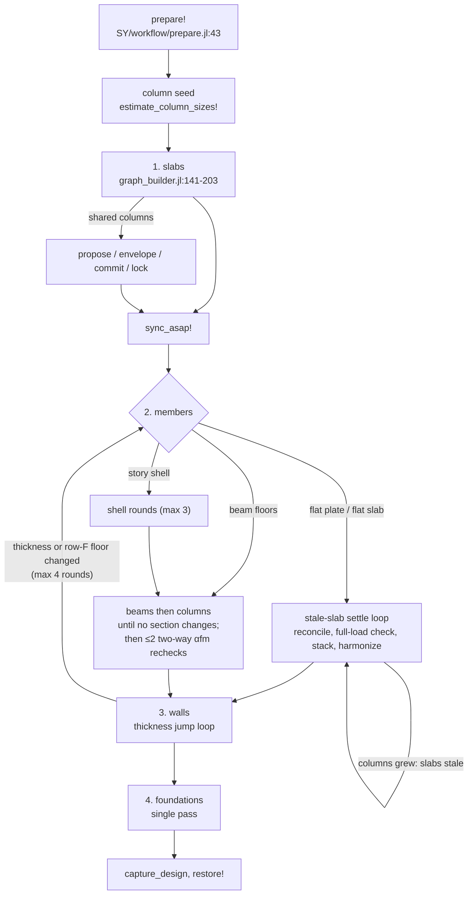

# Sizing map: stages, loops, decision space

A map of how `design_building` sizes a building: the stage order, every
iterative loop, the design variables of each element, and how elements feed
each other's checks. Use it to find where a size is decided before reading
code, and to judge whether a change can move final sizes.

Target design: [`architecture.md`](architecture.md) (where sizing is headed).
Roadmap: [`plan.md`](plan.md). Optimization control layer (relaxation bounds,
Pareto fronts, cost-aware fidelity): [`optimization-architecture.md`](optimization-architecture.md).

Detail lives in four raw reports (one record per loop, file:line cited):

| Report | Covers |
|---|---|
| [`raw/building-pipeline.md`](raw/building-pipeline.md) | Stage table (reads/writes), 11 feedback edges, loops L0–L16, flowchart |
| [`raw/slabs.md`](raw/slabs.md) | Every slab type; flat-plate phases A/B/C, thickness jump, joint search, FEA cache |
| [`raw/members.md`](raw/members.md) | Columns and beams: catalogs, objectives, checks, grouping, MIP, story shell, row-F floors |
| [`raw/walls-lateral-foundations.md`](raw/walls-lateral-foundations.md) | Wall thickness, drift/P-Δ, row F, foundation grouping, spread/strip/mat |

Line numbers are from the working tree on 2026-11-11. Paths: `SS/` =
`StructuralSizer/src/`, `SY/` = `StructuralSynthesizer/src/`.

### Code audit updates since the 2026-11-11 snapshot

Re-audited 2026-11-26 (sign-off queue `plan-9633da9d` / row-f-nlp merged into
`integration/2026-11-18`). Several §6 sign-off items and a §4 rank item that the
2026-11-11/23 text still lists as open are **resolved on the current branch**;
the per-item entries below carry a `RESOLVED (2026-11-26)` prefix. Summary
(memory finding `find-be4cf63c`):

- **Sign-off 1 (cladding dead load) — RESOLVED.** `GravityLoads.wall_SDL`
  (default 10 psf) is now consumed: `_assign_cladding_pressure!` /
  `append_cladding_loads!` (`SY/analyze/asap/asap/cladding.jl`) place `:cladding`
  line loads on the carrying perimeter edge (half to each floor), and the same
  weight enters the unfactored dead case, the service foundation solve, and
  seismic `W`/`Px` via `_deposit_cladding!`. ASCE 7-22 §3.1.1 / §12.7.2
  (vertical split is engineering judgment). `wall_SDL = 0` leaves the façade off.
  (memory `chec-dbb027b0`, `deci-3d324e9c`, `note-e9a2f8ae`.)
- **Sign-off 3 (steel Cm = 0.6) — RESOLVED.** The steel column caller forwards
  the signed FEA end moments: `size_columns.jl:219-222` passes
  `M1x/M2x/M1y/M2y` (from `MemberDemand`, built via `_fem_to_aci_endmoments`),
  so `compute_Cm = 0.6 − 0.4(M1/M2)` is used instead of the `M1 = 0` ⇒ 0.6
  stand-in. AISC 360-16 App. 8 §8.2.1, Eq. A-8-4 (corpus: aisc-360-16, p. 306).
  Unknown-curvature and transversely-loaded members take `Cm = 1.0`.
- **Sign-off 4 (lateral never reaches foundations) — RESOLVED for spread,
  strip, and mat; two narrow pieces remain.** `design_ordinary_walls!` stores
  `foundation_lateral` (rigid-diaphragm masters present), and
  `foundation_actions_at` serves every ASCE 7-22 §2.3 / §2.4 combination to
  **all** footing types by support index. Spread checks each combination;
  strip (`_grow_strip_plan_for_actions`, `_strip_strength_steel`) and mat
  (`_mat_opts_for_actions`, `_demand_for_action(demands[j], column_strength[j][k])`)
  grow the plan until every combination is in the kern with `q_max ≤ qa` and
  design steel per combination (landed 2026-11-26, `chec-4d790ca0`). The
  `_lateral_column_demand` collapse is only the centroid seed / gravity-only
  fallback — overridden per combination whenever `column_strength` is populated.
  **Still open (deferred Phase C/D, needs the held foundation inputs):** the
  ACI 336.2R 20% column-load-variation rule, per-combination flexible-section
  (Winkler) envelopes, sliding and net-tension/uplift demands (soil friction /
  passive inputs), and grade-wall nodes still reading only the gravity
  reaction. (memory `note-e9a2f8ae`, `chec-4d790ca0`.)
- **Sign-off 5 (rigid-mat strip moments) — RESOLVED.** `mat_footing.jl`
  implements rigid-body strip statics per ACI 336.2R §6.1.2 Steps 3–4 (with the
  §5.2 `Kr` rigidity gate); the ACI 318 §8.3.3 beam-coefficient stand-in and the
  swapped-face concern are retired.
- **Rank 11 (RC objectives ignore rebar) — FURTHER RESOLVED: beams now count
  rebar too.** `size_beams` wraps concrete + rebar in a `ReinforcedConcreteMaterial`
  (`SS/members/optimize/api/beams.jl:176`, `_sizing_material`), so
  `precompute_capacities!`'s RC overload threads rebar/transverse into
  `obj_coeffs`. Flat-plate columns (WP 2.5) and beams now both count rebar
  carbon; walls pick thinnest-passing (no carbon MIP) and footings remain the
  last gross-section objective.

Re-audited 2026-11-23 (two-way slabs, lateral sway):

- **Two-way slab with beams now uses the real αfm** (rank 2 / sign-off item 2
  resolved). After the beams exist, `_size_beams_columns!` runs up to two
  `_recheck_two_way_thickness!` + `_resize_beams_after_thickness!` rounds
  (`SY/workflow/member_iteration.jl:385-392`). `_recheck_two_way_thickness!`
  computes each panel's αfm from the sized edge beams (`_panel_alpha` →
  `panel_alpha_fm`) and re-runs `min_thickness(TwoWay(), ln; αfm=…)` with
  Eq. (9-12)/(9-13); it writes the newly computed h, so the slab can **thin**
  when stiff beams allow it. The `alpha_fm = nothing` bound is now only the
  initial seed (before beams) and the fallback when a panel lacks beams on all
  sides. Landed 2026-11-14 (memory checkpoint `chec-4c32c360`), which replaced
  the earlier "two-way thickness stays fixed once the beams are in the shell"
  decision. `Ib` is the beam stem only; §9.5.3.4 computed-deflection thinning
  stays out.
- **Lateral sway: the second-order bridge is built; checker-side consumption
  has landed, pipeline hand-off is the remaining piece** (active LFRS program,
  see memory `chec-ae00f62d`). `StoryStability` (`SS/members/codes/shared/story_stability.jl`)
  carries one first-order story record onto both ACI §10.10.7 `δs` and AISC
  App.8 `B2`; `design_column_moments` (`SS/members/codes/shared/column_moments.jl`)
  returns `Mns + δs·Ms` (RC, Eq. 10-18) or `B1·Mnt + B2·Mlt` (steel, Eq. A-8-1).
  **The steel checker now consumes it:** `is_feasible(::AISCChecker)` takes an
  optional `story` and the `demand.lt` (Mnt/Mlt) split and amplifies through a
  shared core `_aisc_amplified_forces` (`SS/members/codes/aisc/checker/steel_feasibility.jl:88-125`),
  the **same path RC columns use** — one unified RC/steel sway solver. The old
  "B2 not implemented" warning is gone; it now fires only when `braced=false`
  **and** no `story` is supplied. Stages D/E (the `story_stability_records`
  ELF→`StoryStability` adapter, `SY/analyze/lateral/story_demands.jl:372-437`;
  `seismic_design_category`, ASCE 7-22 §11.6) are built. **Remaining
  (pipeline-side):** the Synthesizer member stage must feed `story=` and a
  per-column `lt` (the "colsplit" extraction from the lateral cases) into the
  checker; until then `demand.lt` is empty in production and
  `compute_story_properties!` is not called in the pipeline, so flat-plate
  columns still take their sway designation from the wall-presence proxy and
  use k = 1 both ways (`SS/.../utils/column_bracing.jl`).
- **Rebar now counts in the flat-plate column objective** (rank 11 partially
  resolved — WP 2.5). `_column_cache_material` wraps the column's concrete and
  rebar grades in a `ReinforcedConcreteMaterial`, so `obj_coeffs` include rebar
  carbon under `MinCarbon` (the default), and column picks are objective-ordered
  (`sortperm(cache.obj_coeffs)`) in `_grow_flat_plate_columns!`,
  `_stack_flat_plate_columns!`, and a new within-plan-size pass
  `_fit_flat_plate_columns!` (`SY/workflow/flat_plate_column_check.jl:378-407`).
  P-M capacity is byte-identical; only the objective moved. RC **beams, walls
  and footings** still size on gross section (the rest of Phase 2.5). An
  empirical gate found carbon-ordered column *shrinking* unjustified (≤ 0.5%
  reducible carbon; plan-area min ≈ carbon min), so the grow-only footprint
  ratchet (ranks 1, 3, 5) stands.
- **Ribbed / waffle floors are now sized** (not just thickness-picked). A rib
  grillage story gets a rib depth (`SY/analyze/members/members/rib_story.jl`),
  rib-line member sizing, and cracked-story deflection with a compression-steel
  (ρ′) lever. The member stage gained a `screen_rib_stems!` round loop
  (`RIB_SCREEN_ROUNDS`) and `report_rib_deflection!`
  (`SY/workflow/member_iteration.jl:356-378`). §3's "Waffle" row (table pick +
  head loop) now understates ribbed-floor sizing.
- **Member loop has a verify-installed fallback** (graceful degradation). When
  `_iterate_beams_columns!` / the story-shell path hits `max_iterations` without
  a strict section fixed point, `_verify_installed_design!` accepts the
  installed sections if every beam and column group passes a fresh final-analysis
  check (`SY/workflow/member_iteration.jl:393-408`). This replaces the old
  floored-1.0 "fake pass" at the cap; L9/L11 budget-out no longer just flags
  `stage_diagnostics[:members]`.
- **Speed: several §5 opportunities have landed** (exact / bit-identical).
  Column P-M capacity caches, catalog and plan-groups are hoisted out of the
  settle loop and memoized by content (`speed.md` #10, #20); single-section P-M
  cache memoized; T-beam capacity precompute reused across member iterations
  (−41%); `grillage_bays` and `grow_heads` memoized (−97% / −73%); a
  caller-owned `RigidLinkFactorCache` reuses the reduced factorization across
  lateral P-Δ / exclude-shells solves. §5's "rebuilt per round" items #5 (caches)
  are largely addressed for columns; the FEA remesh-per-column-step (#4) and
  walls⇄members rebuild (#2) remain.

---

## Capabilities and building archetypes

What the sizer can engineer today, which building types that adds up to, and
where the edges are. (Audited 2026-11-23; a capability is "full" when the
pipeline sizes it end to end, "partial" when it sizes but with a known
stand-in or missing check, "none" when it throws or has no designer.)

### By element type

| Element / system | Status | Notes |
|---|---|---|
| Flat plate / flat slab | full | DDM/EFM/FEA, punching + studs/caps/capitals, drop panels, joint search |
| Two-way on beams | full | real αfm feedback (L17); beams sized in the member stage |
| One-way slab | full | ACI deflection tables |
| Waffle / ribbed | partial | rib-depth owner, rib-line sizing, cracked-story deflection (L18); heads grow all corners together |
| Composite steel deck | full | depth × gage enumeration, Vulcraft catalog |
| Vault | full | Haile analytic + shell FEA |
| PT banded, hollow core, non-composite/joist deck | none | throw `UnsupportedFloorSystemError` |
| Timber floors (CLT/DLT/NLT, mass-timber joist) | none | types + NDS checker exist; sizing throws |
| Steel columns / beams | full | AISC 360-16; W/HSS/Pipe; MIP + NLP; composite beams, per-station checks |
| RC columns / beams | full | catalog MIP + NLP; P-M, biaxial, slenderness, torsion |
| PixelFrame (FRC) | full | ACI 318-19 + fib MC2010 |
| Structural walls (lateral) | full | in/out-of-plane, special seismic detailing, drift loop, layout NLP |
| Spread / strip / combined / mat footings | full | rigid / Shukla / Winkler-FEA |
| Deep foundations (piles, shafts, micropiles) | none | typed; no designer |
| Steel moment / braced frames (LFRS) | none | Phase H; lateral is concrete-wall only today |
| Outrigger / belt-truss systems | none | `OutriggerSystem` typed, not implemented |

### Building archetypes we can analyze end to end

| Archetype | Supported? | Caveats |
|---|---|---|
| Mid-rise concrete flat-plate + shear-wall core | yes (best path) | slab → columns → walls → footings all sized |
| Concrete frame: two-way-on-beams / one-way / waffle on columns | yes | ribbed/waffle is partial |
| Steel gravity frame + composite deck + concrete shear walls | yes | lateral still carried by concrete walls, not steel frames |
| Masonry / concrete vaulted structures | yes (specialty) | — |
| Steel high-rise (moment / braced-frame LFRS) | **no** | see "what's left for steel high-rise" below |
| Tall / dynamically wind-sensitive buildings | **no** | no cross-wind / acceleration serviceability; sway not wired |
| Buildings on deep foundations | **no** | no pile/shaft designer; lateral never reaches footings |

The common supported thread: a **concrete or steel gravity system on a column
grid with concrete shear walls for lateral, on shallow foundations** — a large
share of ordinary mid-rise construction.

### What's left for steel high-rise

Steel high-rise needs a lateral-force-resisting system the sizer does not yet
have, plus the second-order and foundation work a tall building forces. Ranked
by how blocking each is (roadmap anchors in brackets):

1. **A steel LFRS designer — the hard blocker.** No steel moment frame or
   braced frame exists; lateral is concrete walls only. Needs: braced frames
   (CBF/EBF/BRBF — brace member design, tension/compression-only Asap
   behavior, EBF links) [Phase H1]; moment frames (rigid connections,
   **panel-zone** shear per AISC J10.6, doubler/continuity plates, member P-M
   under combined actions) [Phase H2].
2. **Wire the sway / second-order machinery (in progress).** Moment frames are
   drift- and stability-governed. **Checker-side is done:** the steel
   `is_feasible` now amplifies `Mr = B1·Mnt + B2·Mlt` / `Pr = Pnt + B2·Plt`
   through the shared `_aisc_amplified_forces` core — the same unified RC/steel
   path as `design_column_moments`. **Remaining:** the pipeline must feed
   `story=` (from `story_stability_records`) and a per-column `lt` split into
   the member stage (the "colsplit" extraction) [Phase A5/H2; LFRS program
   `chec-ae00f62d`].
3. **Drift control as a sizing driver.** Today drift drives wall thickness;
   a steel frame needs drift to drive beam/column *stiffness* (an owner that
   sizes for inter-story drift limits), plus integrated stability/drift
   acceptance and lateral-system selection (braced vs moment vs dual, and
   bracing-bay / moment-line placement) [Phase H4].
4. **Seismic capacity design for steel** (SDC C+): AISC 341-16 ductile
   detailing (SCBF/OCBF, SMF/IMF/OMF, EBF, protected zones, Ry capacity
   design) and AISC 358 prequalified moment connections [Phase H3]. Needs the
   AISC 341/358 corpus ingestion first.
5. **Foundations for high load and overturning.** Deep foundations (piles /
   drilled shafts under high axial + uplift) and the lateral-loads-reach-
   foundations fix (overturning, uplift, sliding, base shear — a signed-off
   gap today) [Phase G, §6 sign-off item 4].
6. **Dynamic wind.** The gust-effect factor for flexible structures and an
   approximate natural frequency exist, but cross-wind response, vortex
   shedding, higher modes, and occupant-comfort acceleration limits do not —
   these govern slender tall buildings.
7. **Composite columns** (concrete-filled tube / encased), common in
   high-rise, are not built (only composite beams are).

Items 1–3 are the minimum to size a *strength-and-drift* steel moment/braced-
frame building in low seismic + ordinary wind; 4–7 extend it to high-seismic,
very tall, and deep-foundation cases.

---

## 1. Stage graph

The pipeline runs once, in this order. There is no outer whole-building loop:
slabs are never re-sized after walls change, and foundations never feed back.

## 2. How elements feed each other

Which variables of one element enter the checks of another. These edges are
where a local sizing decision becomes a building-level one.

| Variable | Set by | Read by | Effect |
|---|---|---|---|
| Column c1, c2 | seed, slab loop, member stage | slab punching (b0), clear span ln = l1 − c1, EFM stiffness, FEA mesh key, foundation punching | Bigger column: easier slab, more column carbon, more moment attracted |
| Slab h | slab loop | cell self weight, column Pu, beam loads, seismic W, wall out-of-plane moment | Thicker slab: heavier everything below |
| Beam stiffness | beam sizing | two-way slab αfm (**not wired**), story-shell demands, column moments | See sign-off item 2 |
| Column section | member stage | frame stiffness, column above/below (stacking) | Stacking forces lower ≥ upper in both dims |
| Wall thickness | wall loop | lateral stiffness, row-F frame floors, member re-size, footing width | Thickening re-runs the whole member stage |
| Frame forces | `sync_asap!` | member demands, foundation reactions | Forces from an earlier, heavier state can persist |

## 3. Decision space by element

| Element | Variables | Candidates | Objective | Loop style |
|---|---|---|---|---|
| Flat plate / flat slab | h, column c1×c2, studs, strip bars; drop depth fixed at ACI min | h on 0.5" grid to ln/10; columns 0.5" steps or RC catalog | Greedy first-pass (default `:grow_columns`), or min carbon (`:joint_search`) | Iterative, grow-only |
| Two-way with beams | h (beams sized by the member stage) | §9.5.3.3: unknown-αfm bound as seed, then Eq. (9-12)/(9-13) at the real αfm | thinnest passing (can thin after beams) | Seed, then ≤ 2 αfm recheck + beam-resize rounds |
| One-way | h | ACI table by thickest support condition | none | Closed form |
| Waffle / ribbed | form/rib depth; solid-head size; rib-line sections; ρ′ | {8…24}" forms; whole rib modules; rib catalog | thinnest passing (ribbed: deflection-governed) | Table pick + head loop; ribbed: rib-depth owner + `screen_rib_stems!` rounds + cracked-story deflection |
| Composite deck | depth × gage | tabulated | min self weight | Exhaustive |
| Vault | rise, thickness | grid / bisection | volume | Grid or bisection |
| RC columns | catalog section or (b, h, ρg) NLP | `rc_column_catalog` 8–36" | gross Ag only (**rebar not counted**) | MIP per pass |
| Steel columns/beams | W/HSS section (+ studs) | AISC catalog | weight / carbon | MIP per pass |
| RC beams | b, h, bars | `rc_beam_catalog` | gross b·h only | MIP per pass |
| Ordinary walls | t per group, ρt, ρl | 1" steps; ρ 0.0005 steps | thinnest passing | Grow-only jump loop |
| Spread footings | B (= L, square), h | 3" plan, 1" depth | smallest B then h | Closed form + bisection |
| Strip / mat footings | L, B, h; mat overhang, h | 3" / 1" steps | first passing | Grow-only loops |
| Timber, hollow core, PT, piles | — | — | — | Not implemented (throws) |

## 4. Ranked: loops that change final sizes

Ranked by how much they can make final sizes larger than needed. "Checked"
means the claim was checked against the code while assembling this map;
the rest are the raw reports' reading-level findings.

| # | Loop / rule | Mechanism | Fix direction | Checked |
|---|---|---|---|---|
| 1 | **Columns never shrink, from a conservative seed** | Seed ≥ building-average span/15 and ≥ axial at ρg = 0.01 over all floors above (`SY/analyze/members/members/size_columns.jl:517-597`). Every later step is `max(old, new)`. `start = :axial` is used only when `column_span_minimum = false` (`SY/workflow/prepare.jl:97-101`) | Seed from the column's own demand; final shrink-and-verify pass | yes |
| 2 | **RESOLVED (2026-11-23 audit).** ~~Two-way slab with beams uses the "beams unknown" thickness bound~~ | The unknown-αfm bound (`SS/slabs/codes/concrete/min_thickness.jl:198-203`) is now only the pre-beam seed. After beams, `_recheck_two_way_thickness!` recomputes αfm and re-runs Eq. (9-12)/(9-13), thinning h (`SY/workflow/member_iteration.jl:385-392`, `:744-784`); ≤ 2 recheck + beam-resize rounds. See the audit note above | Done: size beams, compute αfm, re-check h, re-size beams | yes |
| 3 | **Flat-plate stale-slab loop** | Column growth (axial, full-load P-M, stacking, harmonize) marks slabs stale; redesign can grow columns again; nothing undone (`SY/workflow/graph_builder.jl:373-409`) | Joint slab/column search at building level; size axial before slabs | — |
| 4 | **Flat-plate default punching is greedy** | `:grow_columns` grows columns before considering h or studs; columns grown at a thin h are kept when h rises (`SS/slabs/.../punching_resolution.jl:129-138`, `column_updates.jl:108-109`) | `:joint_search` (built); reset columns on h restart | — |
| 5 | **Full-load column check must cover the current footprint** | Picks lightest catalog section ≥ current c1 and c2; never trades footprint for steel (`SY/workflow/flat_plate_column_check.jl:461-473, 635-640`) | Choose among sections ≥ the *required* footprint | — |
| 6 | **Uniform wall drift fix** | Worst story/direction drift ratio still scales every wall group. The default grouping is `:pier`, so a local pier failure thickens that wall only (`SY/design/parameters.jl`, `wall_thickness_jump.jl`) | Per-direction, per-group drift sensitivity (`SS/walls/lateral/sensitivity.jl` exists, unused) | — |
| 7 | **RESOLVED (2026-11-26): Mat reinforcement** | Now rigid-body strip statics per ACI 336.2R §6.1.2 Steps 3–4, gated by the §5.2 `Kr` rigidity check (`SS/foundations/codes/aci/mat_footing.jl`). Retired the ACI 318 §8.3.3 beam-coefficient stand-in and the swapped-face concern; see sign-off item 5 | — (resolved) | yes |
| 8 | **Foundation grouping envelope** | Component-wise max of P, M, V, c over a ±15% cluster whose reference only grows (`SY/analyze/foundations/grouping.jl:144-151, 300-325`) | Sort descending, bound by group min; concurrent demands | — |
| 9 | **Column stacking and harmonize** | max c1 and max c2 taken independently: 12×20 over 20×12 forces 20×20 (`flat_plate_column_check.jl:492-551`, `member_iteration.jl:72-73`). Both are design policy, not code | Compare by area / allow rotation; joint group sizing in MIP | — |
| 10 | **Section floors never relax** | Row-F seismic floors and story-shell `section_floor` are objective-sorted masks kept for the run; shell rounds 2–3 skip the trim pass (`interactive_checks.jl:903-920`, `size_beams_story_shell.jl:200-216`) | Store floors as demand rows; trim on the last round | — |
| 11 | **PARTIAL (2026-11-26): flat-plate columns AND beams count rebar** (WP 2.5); walls/footings still gross | Flat-plate column cache (`SY/workflow/flat_plate_column_check.jl:378-407`) and `size_beams` (`SS/members/optimize/api/beams.jl:176`, `_sizing_material`) both route through `ReinforcedConcreteMaterial`, so `obj_coeffs` include rebar carbon. Walls pick thinnest-passing (no carbon MIP); footings still size on gross section | Add As·ρs·ecc_s to the footing objective (last gross RC objective) | yes |
| 12 | **Drop panels, pattern loading, h-dependent edge beams lose scaling and joint search** | Fall back to blind 0.5" steps; drop depth/extent never sized (`thickness_jump.jl:51-57`) | Scale D and L separately; add drop variables to the joint search | — |
| 13 | **Group envelopes (members)** | Max P paired with max M, longest L, worst Lb/Cb/K across a group (`SY/analyze/members/members/demands.jl:560-723`) | Check each member against the shared section | — |
| 14 | **Wall out-of-plane moment** | Max slab moment paired with every N, including 0.9D (`ordinary_wall_stage.jl`). The reinforcement ratio is re-picked from the §11.6.2 floor on every call | Concurrent Moop/N | — |
| 15 | **Footing shape rules** | Square spread footings under one-way moment; strip h ≤ 0.5B (rule of thumb) | Rectangular B×L; joint (B, h) min-volume | — |

Smaller items: rectangular columns over-grown by reconcile (compares each side
to √Ag_req); `collinear_grouping` has no effect; waffle heads grow all four
corners together; composite deck always uses simple-span wL²/8; one-way slabs
take the thickest support condition over all cells.

## 5. Ranked: loops that cost time

| # | Hot spot | Why | Opportunity |
|---|---|---|---|
| 1 | Flat-plate stale-slab loop | k slab redesigns + full sync + nested reconcile/check settle per round (budget 48) | Re-check instead of redesign when a column only grew; joint search |
| 2 | Walls ⇄ members | Up to 4 × entire member stage; each wall pass is a full `to_asap!` rebuild + 4–6 K_G solves | Mutate shell thickness in place (mat Winkler path already does); re-size only members whose demand moved |
| 3 | Beam ⇄ column loop | 2 MIPs + 2 stiffness rebuilds per pass, up to 20 passes; exact-identity stop can 2-cycle | Persist capacity caches; warm start; cycle detection; per-group demand tolerance |
| 4 | FEA flat plate | Column sizes are in the mesh key, so every column step re-meshes (`SS/slabs/.../fea/cache.jl:169-182`) | Fixed mesh with patch stiffness; batch column growth |
| 5 | Capacity caches rebuilt per round | Full-load check and stacking rebuild P-M caches every round; MIP memo keyed on `objectid(catalog)` misses rebuilt catalogs | Hoist caches out of loops; key on catalog value |
| 6 | Winkler mat | Linear 1" sweep, active-set FE solve per step | Bisection on h; warm-start active set |
| 7 | `n_max_sections == 0` MIP | Separable problem solved through JuMP | Per-group argmin (as `optimize_binary_search` does) |

## 6. Needs sign-off before any change

These change code-derived values or may be unsafe. Per `code-accuracy.mdc`
and `corpus.mdc`, each needs a corpus check and the user's sign-off.

1. **RESOLVED (2026-11-26): cladding dead load is now applied.**
   `GravityLoads.wall_SDL` (default 10 psf) is consumed as `:cladding`
   perimeter line loads (half of each façade band to the floor at each end)
   and enters the unfactored dead case, the service foundation solve, and
   seismic `W`/`Px` (`SY/analyze/asap/asap/cladding.jl`, `_deposit_cladding!`);
   ASCE 7-22 §3.1.1 / §12.7.2, vertical split is engineering judgment.
   `wall_SDL = 0` leaves the façade off. Was: `wall_SDL` had no consumer, so
   façade weight was missing from perimeter-member gravity design, foundations,
   W and Px. Research in
   [`phase0/seismic-weight-and-foundation-lateral.md`](phase0/seismic-weight-and-foundation-lateral.md)
   (Issue A).
2. **RESOLVED (2026-11-23):** two-way slab thickness now uses the real αfm
   (ranked item 2; landed 2026-11-14). The unknown-αfm bound is only the
   pre-beam seed; `_recheck_two_way_thickness!` recomputes αfm from the sized
   beams and re-runs Eq. (9-12)/(9-13). No open sign-off here.
3. **RESOLVED (2026-11-26): steel Cm uses the signed frame end moments.**
   `SY/analyze/members/members/size_columns.jl:219-222` forwards
   `M1x/M2x/M1y/M2y` (from `MemberDemand`, built via `_fem_to_aci_endmoments`)
   to the array `size_columns`, so `compute_Cm = 0.6 − 0.4(M1/M2)` is used
   (AISC 360-16 App. 8 §8.2.1, Eq. A-8-4; corpus aisc-360-16 p. 306).
   Unknown-curvature and transversely-loaded members take Cm = 1.0. Was: only
   Pu, Mux, Muy were forwarded, rebuilding `MemberDemand` at M1 = 0 ⇒ Cm = 0.6,
   under-amplifying moment terms by up to 1.67× (tens of percent on slender
   gravity columns). Research in
   [`phase0/steel-cm-and-mat-coefficient.md`](phase0/steel-cm-and-mat-coefficient.md)
   (Issue C).
4. **RESOLVED (2026-11-26) for spread, strip, and mat; two narrow pieces
   remain.** `design_ordinary_walls!` stores `foundation_lateral` (when
   rigid-diaphragm masters exist), and `foundation_actions_at(struc, idx)`
   serves every ASCE 7-22 §2.3 / §2.4 combination to **all** footing types by
   support index — not just spread. Spread checks each combination; strip
   (`_grow_strip_plan_for_actions`, `_strip_strength_steel`) and mat
   (`_mat_opts_for_actions`, `_mat_strength_sets`) grow the plan until every
   combination is in the kern with `q_max ≤ qa` and design steel per
   combination via `column_strength[j][k]` (foundation Phase A+B, 2026-11-26,
   `chec-4d790ca0`). `_lateral_column_demand`'s single-demand collapse is only
   the mat centroid seed and the gravity-only fallback; it is overridden per
   combination whenever `column_strength` is populated. **Still open** (deferred
   Phase C/D, gated on the held foundation inputs): the ACI 336.2R 20%
   column-load-variation rule, per-combination flexible-section (Winkler)
   envelopes, sliding / net-tension / uplift demands (soil friction and passive
   inputs), the §12.13.4 overturning reduction, and grade-wall nodes still
   reading only the gravity reaction (`wall_groups.jl:418-424`). Was: footing
   strength used the last gravity full-load solve's reactions and bearing one
   unfactored D + L solve, so no lateral reached any footing; a hand calc passed
   a strip footing at 76 kPa (D + L) that ASD seismic takes to 98 kPa against
   qa = 80 kPa. Research in
   [`phase0/seismic-weight-and-foundation-lateral.md`](phase0/seismic-weight-and-foundation-lateral.md)
   (Issue B).
5. **RESOLVED (2026-11-26): rigid-mat strip moments use rigid-body statics.**
   `mat_footing.jl` now implements ACI 336.2R §6.1.2 Steps 3–4 rigid-body strip
   statics (gated by the §5.2 `Kr` rigidity check), replacing the ACI 318
   §8.3.3 beam-coefficient stand-in and resolving the swapped-face concern.
   Was: beam coefficients sent the support coefficient to top steel and the
   span coefficient to bottom steel (faces looked swapped for upward soil
   pressure), gave span moments 1.9×–3× low, and dropped overhang cantilever
   moment. Research in
   [`phase0/steel-cm-and-mat-coefficient.md`](phase0/steel-cm-and-mat-coefficient.md)
   (Issue D).

## 7. Cross-cutting patterns

The fifteen size-impact items are mostly instances of five patterns. A fix at
the pattern level usually covers several of them.

- **Grow-only ratchets with a conservative start.** Columns, walls, wall ρ,
  section floors, footing plans. Remedy: seed from demand, then a final
  shrink-and-verify pass, or replace the ratchet with a search (as
  `:joint_search` does for flat plates).
- **First-failure greedy fixes.** The first failing check picks which
  variable grows (punching grows columns; drift grows every wall). Remedy:
  cost-ranked choice among levers.
- **Envelopes of non-concurrent demands.** Max P with max M across members,
  cases, slabs, groups. Remedy: check per member/case against a shared section.
- **Independent per-dimension max.** c1 and c2 maxed separately in stacking,
  harmonize, slab-loop column updates. Remedy: compare whole sections.
- **Stand-ins that are never replaced.** Column seed, square footings. (The
  two-way αfm bound was this pattern's example and is now replaced by the
  αfm recheck — see the 2026-11-23 audit note.) Remedy: a second pass once
  the real value is known.

## 8. Keeping this map current

When a change adds, removes or alters a sizing loop, update the matching raw
report record and, if its rank changes, the tables above. Each raw record
uses the same fields (location, decision variables, inputs/outputs, stop rule,
monotone, order dependence, cost, size impact, speed impact, opportunities,
confidence), so new records should follow that shape.
