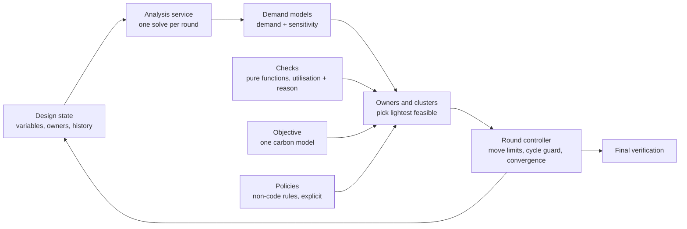

# Sizing architecture: lightest code-compliant structure

Status: draft for discussion (2026-11-11). Companion to [`plan.md`](plan.md)
(phases) and [`README.md`](README.md) (current state). The control layer that
drives the owners/round-controller — continuous-relaxation bounds, multi-objective
Pareto fronts, and a cost-aware fidelity scheduler — is specified in
[`optimization-architecture.md`](optimization-architecture.md).

## 1. The problem, stated plainly

Choose every design variable in the building (slab thickness, column and beam
sections, wall thickness and steel, studs, drop panels, footing dimensions) to
minimise embodied carbon, subject to every code check passing under the
demands that those same choices produce.

Three properties make it hard:

- **Demands depend on the design.** Self-weight scales with size, and
  stiffness decides where moment and lateral load go. Getting demands takes a
  full analysis, which is the expensive step.
- **Variables are discrete.** Catalog sections, 0.5" thickness steps, bar
  sizes. Gradient methods only help inside a few subproblems.
- **Elements are coupled through shared supports.** A column is checked by
  the slab above it, the slab below it, the frame, the footing and the walls
  beside it.

A provable global optimum is not a realistic target. The realistic target is:

1. **Verified:** every reported design passes every check at its final
   demands, from a final analysis.
2. **Path-independent:** the result does not depend on processing order, the
   starting guess, or the order checks happen to fail in.
3. **Locally optimal, with a measured gap:** no single variable can be made
   lighter without failing, and we know how far each element is from the
   lightest size its own final demands allow.
4. **Fast:** few full analyses, so the sizer can sit inside an outer loop that
   explores layouts and systems.

Today the pipeline meets (1) and is fast in places. It misses (2) and (3)
because sizes only grow from a guess and the first failing check decides what
grows.

## 2. The approach: sequential approximate optimisation

Structural optimisation has a well-tested answer to "analysis is expensive,
checks are cheap": alternate between one real analysis and a cheap
approximate subproblem.

```text
repeat
    analyse the building once at the current design
    for each element: build demand models (demand now + how it changes with x)
    solve the cheap subproblem: lightest x meeting all checks under the models,
        within move limits
    if x did not change: stop
verify: final analysis + all checks at final x
```

The flat-plate `:joint_search` is already a small version of this. It does one
analysis, scales demands to each candidate thickness, scans thickness × column
× studs on carbon, then confirms with a real analysis. The architecture
generalises that pattern to the whole building.

Move limits and the hybrid cycle rule keep it stable: a variable may move at
most a few catalog steps per round, and one that oscillates becomes grow-only.

## 3. Components



| Component | Responsibility | Built today |
|---|---|---|
| **Design state** | Every variable in one registry: owner, domain (catalog or grid), current value, history, governing reason. Single writer per variable. | Scattered fields on `BuildingStructure`; columns have about seven writers |
| **Analysis service** | One building solve per round; cheap updates when only values change | Asap, `sync_asap!`, values-only `update!`, factorization token, pattern D/L split, story shell, slab FEA/EFM/DDM |
| **Demand models** | Demand at the current design plus how it moves with each variable | Thickness scaling (`loads_at_thickness`, `scale_moment_result`), wall-thickness proxy (`scale_wall_action`), `story_drift_sensitivity` (unused) |
| **Checks** | Pure functions: (element, local variables, concurrent demand set) → utilisation per check and governing check. No mutation. | ACI/AISC checkers, P-M capacity caches, punching and studs, wall checks, footing checks |
| **Owners** | One per variable family. Given requirements, pick the lightest feasible value. | Discrete MIP, binary search, NLP columns/beams, catalogs, deck enumeration, vault bisection |
| **Clusters** | Joint subproblems where variables are tightly coupled; return values for several variables | Flat-plate `joint_search`; wall layout NLP with `MinCarbon` (unused); flat-plate grid optimiser |
| **Objective** | One carbon model over every material: concrete, rebar, steel, studs, walls, fireproofing | `material_objective`, `ec.jl`; RC objectives ignore rebar; walls have no carbon |
| **Policies** | Non-code rules (uniform sizing, grouping, stacking) declared separately from code constraints, so the optimiser knows what is optional | Mixed into sizing code |
| **Round controller** | Move limits, hybrid cycle rule, convergence, skipping owners whose requirements did not change | `settle!`, `monotone_budget`, design-graph fingerprints, snapshots |
| **Verification and explanation** | Final analysis and full check; per-variable governing reason and oversize relative to its own lightest feasible size | Stale-design stamps, `TraceCollector`, `stage_diagnostics` |

## 4. Where coupling is handled

The hard part is deciding which interactions get a joint subproblem and which
are handled by iterating rounds.

**Joint subproblem (cluster):** use when the trade-off is the point of the
design and demand models make it cheap.

- Slab + supporting columns + studs (flat plate; extend to flat slab with drop
  depth and extent).
- Walls for drift: thicknesses, and eventually lengths, chosen together using
  drift sensitivity, against column and slab-frame stiffness, on carbon.
- Footing plan × depth.
- Beam + slab for two-way systems (αfm couples them).

**Rounds:** use when the effect is weak or smooth.

- Self-weight from floors to columns, footings and seismic weight.
- Stiffness redistribution between frames.
- Column size into slab punching on other floors.

**Concurrent demand sets everywhere.** Each check gets the cases that actually
occur together, not envelopes. Owners and clusters read the same sets.

## 5. Two levels

- **Inner level, this architecture:** sizing for a fixed layout and system
  choice.
- **Outer level:** layout and system choice (floor system, wall placement,
  column grid, wall versus frame). It is explored by running the inner level
  many times; `sweep_design_building` and the run ledger already support this.

The outer level is only meaningful if the inner level is path-independent and
fast. Otherwise the comparison between two layouts is noise from the sizing
path, which is the main argument for doing this work before layout
optimisation.

### Two tiers: exploration and verification

The outer level needs sizing in milliseconds to seconds; trust needs the full
sizer. So every element type gets two fidelities behind the same interface:

- **Fast tier:** cheap demands (closed form where the geometry allows,
  coarse FEA elsewhere), the same checks, the same owners. Used to explore and
  rank layouts and systems.
- **Full tier:** today's sizer (fine FEA, punching, P-Δ, walls, MIPs, joint
  searches) plus the verifier. Run only on shortlisted options.

Requirement: **a fast version for everything we design**, including
unconventional layouts (irregular slab outlines, waffles on odd grids,
setbacks, openings). Tributary rules alone cannot provide that, so the fast
tier for irregular geometry is coarse FEA, made cheap by:

- **Superposition.** Solve unit cases once per geometry (self-weight per unit
  thickness, SDL, live, patterns) and combine linearly. For a slab of uniform
  stiffness, the internal force distribution does not depend on thickness, so
  demands at any candidate h are exact from one solve. The thickness-jump
  scaling already uses this. It is approximate where relative stiffness
  changes (drop panels, solid heads versus ribs, beams), and the error there
  must be measured.
- **Reuse.** Geometry is fixed while sizing, so meshes and factorizations are
  built once per layout; typical bays and repeated floors are fingerprinted
  and cached.
- **Smeared models.** Waffles and ribbed slabs as equivalent orthotropic
  plates in the fast tier; explicit ribs and solid heads in the full tier.
- **Superelements.** Each uniform-thickness slab region is condensed once
  per geometry to its boundary and connection DOFs; its condensed stiffness
  scales by (h/h₀)³, so a thickness candidate is a tiny solve. Columns are
  rigid rings on a fixed mesh, and changes update the factorization by
  low-rank (Woodbury) updates instead of refactoring. See `plan.md` 7.8–7.10.

Fidelity ladder (to confirm in the code audit):

| Element | Fast tier | Full tier |
|---|---|---|
| Flat plate / flat slab | DDM/EFM where applicable, else coarse FEA by superposition | Fine FEA, punching, joint search |
| Waffle, ribbed, irregular | Coarse orthotropic plate FEA | Rib frames + shell FEA |
| Beams, columns (gravity) | Tributary or coarse-frame demands, catalog lookup | Full frame, MIP, P-Δ |
| Walls, lateral | ELF, rigid diaphragm, analytic wall stiffness, drift sensitivity | Shell model, wall checks, thickness loop |
| Foundations | Rigid statics | Winkler / Shukla, combinations |

Rules:

1. **Checks and owners are shared.** Only the demand source differs between
   tiers. Fidelity is a property of the analysis service, not something baked
   into each designer. Today several designers embed their analysis method
   (the flat-plate kernel runs DDM/EFM/FEA inside itself); separating the two
   is the main refactor this needs.
2. **Code-restricted methods stay within their limits.** DDM and EFM are used
   only where their applicability checks pass; coarse FEA covers the rest.
3. **Calibrated, not assumed.** Each fast model has a measured error band
   against the full tier, per element type and per system. Ranking is safe
   when the bias is similar across the options being compared; it is not when
   one system's fast model is conservative and another's is not, so the bands
   are tracked per system.
4. **Shortlist by bands.** Every option whose fast-tier carbon band overlaps
   the best one goes to full verification.
5. **Only verified designs are reported as designs.** Fast-tier results are
   labelled estimates.

## 6. Measures of success

From the Phase 1 baseline onward, every change reports:

- carbon by element type;
- full analyses per run and runtime by stage;
- **oversize** per element: final size versus the lightest size its own final
  demands allow;
- **path independence:** the same building sized with reordered slabs and a
  different column seed gives the same design.

## 7. Modularity and auditability

The design must be quick to audit and verify. Rules that follow from that:

- **The verifier is the trust anchor, and it stays simple.** Final
  verification uses only a full analysis plus the checks. It shares no code
  with the demand models, move limits or clusters. The optimiser may be
  clever; the verifier may not.
- **Checks are pure and small.** One function per code check, citing its
  clause, unit-tested against worked examples. Checks never mutate state and
  never choose sizes.
- **Owners share one interface.** Requirements in; chosen value, utilisation
  and governing check out. Any owner can be tested alone with hand-built
  requirements.
- **Every round leaves an audit record.** For each variable: the
  requirements it saw, the value chosen, the governing check, and whether a
  move limit or the cycle rule constrained it. A reviewer can see why
  anything is the size it is without rerunning.
- **Policies are named and switchable.** Every non-code rule is a declared
  policy, so an auditor can tell code requirements from engineering
  judgement.

## 8. Decisions

- **Design state lives beside `BuildingStructure`** (2026-11-11).
  `BuildingStructure` stays the physical model. The registry holds variables
  keyed by element id, and a single `apply!` writes chosen values back. The
  risk is two sources of truth; the rule that prevents it is that sizing
  fields on `BuildingStructure` are written only by `apply!`, with a test
  that asserts it.
- **Demand models versus re-analysis: measure per element type** once the
  Phase 1 baseline exists (2026-11-11). Metric: how far the model's predicted
  demand is from the next analysis, and how many rounds it saves.

## 9. Getting there from here

No rewrite. Wrap the existing stages, then move one variable family at a time
into the registry, keeping today's solvers as the owners' internals.

Phase numbers refer to `plan.md`.

1. Safety fixes and baseline (Phases 0–1).
2. Design-state registry and round controller around the current stages,
   with no behaviour change; proves the plumbing against the baseline
   (Phase 2).
3. Columns become the first owner, with the flat-plate joint search as the
   first cluster reporting requirements (Phase 3).
4. Concurrent demand sets (Phase 4).
5. Walls become an owner, plus a drift cluster and wall–slab feedback
   (Phase 5).
6. Stand-ins, slabs, beams and footings; policies separated and the old
   grow-only paths retired (Phase 6).

At each step the benchmarks must show no loss of verification, and
measurable changes in carbon, oversize, path independence or analysis count.

## 10. Open questions

- Move-limit sizes per variable family.
- Which clusters justify an exact search versus a heuristic.
