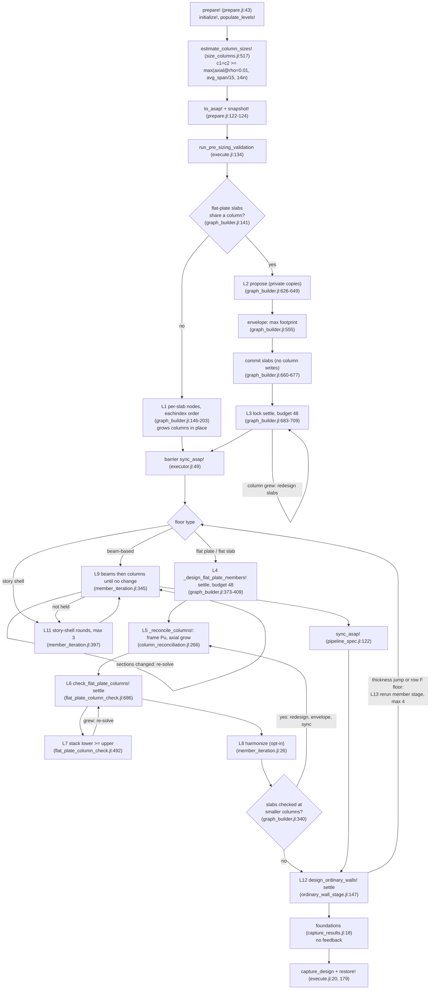

# Building-pipeline sizing map (StructuralSynthesizer)

Scope: `StructuralSynthesizer/src/workflow/*`, `design_graph/*`, `floor_design_contracts.jl`, `core/*`.
Paths are relative to `StructuralSynthesizer/src/` unless prefixed `SS/` (= `StructuralSizer/src/`).
Status: COMPLETE (Parts A, B, C and the top-5 list).

### Loops added since the 2026-11-11 snapshot (2026-11-23 audit)

These are not yet written up as full L-records below; anchors given for follow-up:

- **L17 — Two-way αfm recheck** (`member_iteration.jl:385-392`, helpers `:744-784`).
  After the beam/column fixed point, up to 2 rounds of `_recheck_two_way_thickness!`
  (recompute αfm from the sized edge beams → `min_thickness(TwoWay(); αfm)`,
  can thin h) + `_resize_beams_after_thickness!`. Resolves rank 2 / the two-way
  αfm stand-in. Monotone: no (h can drop). Budget: 2.
- **L18 — Rib-stem screen rounds** (`member_iteration.jl:356-378`, `RIB_SCREEN_ROUNDS`).
  For grillage (ribbed/waffle) stories: `screen_rib_stems!` → reanalyze → L9,
  repeated until the stem screen keeps every stem; then `report_rib_deflection!`.
  Rib depth owned by `analyze/members/members/rib_story.jl`; cracked-story
  deflection with a ρ′ lever.
- **Member verify-installed fallback** (`member_iteration.jl:393-408`). On
  `max_iterations` without a strict fixed point, `_verify_installed_design!`
  accepts the installed sections if every group passes a fresh final analysis
  (replaces the floored-1.0 fake pass; changes the L9/L11/L13 budget-out
  outcome — it can now converge=true at the cap).
- **Flat-plate column objective now rebar-inclusive + `_fit` pass** (WP 2.5,
  `flat_plate_column_check.jl:378-407`). L5/L6/L7 picks are objective-ordered
  on rebar-inclusive `obj_coeffs`; a within-plan-size `_fit_flat_plate_columns!`
  pass was added. Footprint is still grow-only (empirical gate: carbon-ordered
  shrinking ≤ 0.5%).

Many L4–L13 speed opportunities below have since landed (P-M cache hoist,
single-section/T-beam/grillage_bays memos, `RigidLinkFactorCache`); see the
README §5 audit note.

---

Shared iteration primitives (SS/iteration.jl):
- `monotone_budget(requested, span; ceiling=48)` = `max(requested, min(span, 48))` (SS/iteration.jl:35-43).
- `settle!(step!; budget)` runs `step!(k)` until it returns `false` (`:settled`) or `budget` passes (`:budget`, converged=false) (SS/iteration.jl:56-63).
- Default `params.max_iterations = 20` (design/parameters.jl:286); `uniform_column_sizing = :off` (parameters.jl:217); `jump_wall_thickness = true` (parameters.jl:270).

---

## PART A — Stage graph

Entry: `design_building` (workflow/execute.jl:205) → `DesignSession` (execute.jl:221) or, with `restore=false`, `_design_building_inplace` (execute.jl:120). Both run the same sequence:

| # | Stage | Function (file:line) | READS | WRITES |
|---|---|---|---|---|
| 0a | Prepare | `prepare!` (workflow/prepare.jl:43) → `initialize!` (prepare.jl:62), `populate_levels!` (prepare.jl:87) | geometry, params.loads, floor opts | cells (sdl, live, **self_weight estimate**), slabs (estimate result), columns/beams/segments, tributaries |
| 0b | Column seed | `estimate_column_sizes!` (prepare.jl:100; analyze/members/members/size_columns.jl:517) | tributary area, qu (fallback 200 psf), n stories above, avg span | **col.c1/c2 seed** = max(axial Ag @ ρ=0.01 × n_above floors, (avg_span/15)², 14") (SS/slabs/codes/concrete/flat_plate/utils/calculations/deflection.jl:242-281); `start=:axial` drops span/15 only if `column_span_minimum=false` (prepare.jl:97-99) |
| 0c | Model | `to_asap!` (prepare.jl:122), `snapshot!` (prepare.jl:124) | everything above | `asap_model` (placeholder frame sections, no member self-weight), pristine snapshot |
| 0d | Validation | `run_pre_sizing_validation` (execute.jl:134) | slabs/geometry | — (throws) |
| 1 | Slab sizing | Graph: per-slab roots `:slab_sizing_s{i}` in `eachindex` order (workflow/graph_builder.jl:146-203) **or** propose→envelope→commit→lock when flat-plate slabs share columns (graph_builder.jl:141-145, 617-711). Legacy equivalent `design_floors!` (floor_design_contracts.jl:293-349). Each node: `design_floor!` (floor_design_contracts.jl:439) = `design_floor` (:177) + `install_floor_design!` (:359) + `_update_one_slab_volume!` (graph_builder.jl:904) | live `col.c1/c2/shape/section` of supporting columns AND `column_above` (floor_design_contracts.jl:65-86, 20-31), cells loads, slab spans | `slab.result`, `slab.design_details` (+ `designed_supports`/`designed_above` stamps, :403-413), `slab.drop_panel`, `cell.self_weight/live_load` (:416-420), **col.c1/c2/shape/section/volumes** (:421-430, grow-only from inner kernel SS/.../pipeline/column_updates.jl:108), `slab.volumes` |
| 1s | Barrier sync | `execute_graph!` level barrier (design_graph/executor.jl:39-53) → `sync_asap!` (analyze/asap/asap/model_sync.jl:120) | slab results, sections | cells.self_weight from slab.result (model_sync.jl:124-129), tributary pressures, member self-weight, fire coating; full re-assemble + solve (patterns if enabled) |
| 2 | Members | `:members` node (graph_builder.jl:210-213); flat → `_design_flat_plate_members!` (graph_builder.jl:373); beam-based → `_size_beams_columns!` (workflow/member_iteration.jl:210); all-flat `:two_way` rerouted (graph_builder.jl:313-333) | `asap_model` forces, slab design_details (column_results, joint moments), columns, beams | flat: col c1/c2/section/volumes + frame sections + offsets, slab redesign (result/details/cells), re-solve; beam: beam & column sections, frame sections, re-solves. `stage_diagnostics[:members/:flat_plate_columns]` |
| 2s | Sync | needs_sync = `!flat` (workflow/pipeline_spec.jl:122) | | full `sync_asap!` after beam path; flat path self-syncs |
| 3 | Ordinary walls | `_walls_with_member_recheck!` (pipeline_spec.jl:166) → `design_ordinary_walls!` (analyze/lateral/ordinary_wall_stage.jl:147) | asap_model, walls, params.lateral | `wall.thickness` (jump → remesh/`to_asap!` inside), `ordinary_wall_result`, `frame_section_floors` (row F; analyze/lateral/interactive_checks.jl:919) |
| 4 | Foundations | `:foundations` node (graph_builder.jl:232-240) → `_size_foundations!` (workflow/capture_results.jl:18) | solved reactions (depends on `:members` and walls) | `struc.supports`, `struc.foundations` (no model change, no feedback) |
| 5 | Capture | `capture_design` (execute.jl:20) | all | `BuildingDesign` copy; `converged = all_ok && isempty(stage_diagnostics)` (execute.jl:75) |
| 6 | Restore | `restore!` (execute.jl:179; core/snapshot.jl) | snapshot | pristine member dims |

### Feedback edges (later stage → earlier stage re-run / invalidation)

1. **Slab k → slab j (j>k), same level**: slab k grows a shared column in place; slab j reads the larger c1 (ln = l1 − c1, punching perimeter). Order dependence; no re-run of slab k (graph_builder.jl:19-24, 146-203). Only removed when slabs share columns → two-level path.
2. **Envelope → commit → lock → commit (two-level)**: envelope grows a column beyond a slab's own proposal ⇒ that slab re-designed against it; repeated in lock until nothing grows (graph_builder.jl:660-709).
3. **Members (flat) → slabs**: `_reconcile_columns!` / `check_flat_plate_columns!` / harmonize grow columns ⇒ slabs whose `designed_supports`/`designed_above` stamp no longer matches are re-designed (`_stale_flat_plate_slabs`, graph_builder.jl:340-343, 505-519) ⇒ slab proposals may grow columns again ⇒ sync ⇒ reconcile again (graph_builder.jl:382-398).
4. **Slab depth → frame Pu → columns**: slab redesign changes cell self-weight ⇒ `sync_asap!` (graph_builder.jl:394) ⇒ reconcile reads new Pu.
5. **Column size → frame Pu (self-weight) + §13.6.9.2 stiffness split → column check**: `check_flat_plate_columns!` re-solves after each growth round (workflow/flat_plate_column_check.jl:697-707).
6. **Column below ← column above (stacking)**: `_stack_flat_plate_columns!` grows a lower column to cover the upper (flat_plate_column_check.jl:492-551).
7. **Beams ↔ columns** (beam path): beam sizes change column demand & column stiffness changes beam moments; full re-solve between (member_iteration.jl:345-377).
8. **Story shell ↔ beam/column loop**: shell demands depend on beam/column stiffness (member_iteration.jl:397-459).
9. **Walls → members**: wall thickness jump (remesh), row-F `frame_section_floors`, or an RC frame column failing P–M on the wall solution ⇒ whole member stage re-run (incl. its own inner loops) ⇒ walls re-checked (`_walls_with_member_recheck!`).
10. **Members/walls → foundations**: one-way; foundations never feed back (pipeline_spec.jl:135).
11. **Incremental scheduler**: always restarts from the prepared baseline (design_graph/scheduler.jl:496), so there is no cross-run ratchet; a (currently unreachable) partial slab overlay max-merges shared columns via `_adopt_larger_column!` (core/snapshot.jl:484-525; scheduler.jl:641-651).

---

## PART B — Loop records

### L0 Column seed (not a loop, but the ratchet origin)
- location: workflow/prepare.jl:94-101, `prepare!` → analyze/members/members/size_columns.jl:517-590 `estimate_column_sizes!` → SS/slabs/codes/concrete/flat_plate/utils/calculations/deflection.jl:242-281 `estimate_column_size`
- decision variables: initial col.c1 = col.c2 (square, rounded up to whole inch)
- inputs / outputs: tributary area, qu from cells (fallback 200 psf), `n_above = n_stories − col.story`, building-wide `avg_span` (`_estimate_avg_span(skel)`), column f′c → seeds every downstream grow-only loop
- stop rule + budget: n/a (single pass)
- monotone? It sets the FLOOR: every later step is `max(old, new)` (SS/.../pipeline/column_updates.jl:108; SS/.../utils/column_growth.jl:174-204, 268, 315). Docstring states "Column sizing only grows, so the start is the smallest column the design can return" (size_columns.jl:490-492).
- order dependence: none
- cost per pass: trivial
- size impact: **HIGH**. With default `start=:span` the seed is ≥ avg_span/15 and ≥ 14", using one building-wide average span (not the column's own spans), plus an axial estimate that multiplies factored qu by every floor above at ρg = 0.01. Any column that the code checks would allow smaller is locked at this seed forever (no shrink step exists anywhere in the pipeline). Edge/corner columns get the same square seed as interior (size_columns.jl:566-575).
- speed impact: LOW
- opportunities: seed from per-column spans; default `:axial` start (14" min) and let punching grow; or add a final "shrink-and-verify" pass (try next smaller catalog section, re-run checks) since all loops are grow-only; record seed-governed columns in diagnostics.
- confidence: verified-by-reading

### L1 Sequential per-slab sizing (no shared columns)
- location: workflow/graph_builder.jl:146-203 (`_make_slab_node_fn` :736-760); legacy `design_floors!` floor_design_contracts.jl:322-345
- decision variables: per slab h (inner kernel), drop panel, **supporting column c1/c2/section** (grown in place and installed immediately via `install_floor_design!` floor_design_contracts.jl:421-430)
- inputs / outputs: live supporting columns + column_above of *all* slabs; writes slab result, cells self_weight, columns → feeds L2/L4 and the barrier `sync_asap!`
- stop rule + budget: single sweep over `eachindex(struc.slabs)`; inner slab kernel bounded by `max_iterations` (passed at graph_builder.jl:746)
- monotone? columns: yes, inner kernel never shrinks (SS/.../column_updates.jl:108). h: restarts from `min_thickness` each design (SS/.../pipeline/iteration.jl:120-131), so h is not ratcheted.
- order dependence: **YES** — explicitly pinned to `eachindex` (graph_builder.jl:11-31). Applies only when no two flat-plate slabs share a column (`_flat_plate_slabs_share_columns`, graph_builder.jl:418-430) — so for flat plates it effectively covers single-slab-per-column layouts and non-flat floors.
- cost per pass: one slab design per slab (DDM/EFM/FEA inside kernel); non-flat floors `deepcopy(struc)` per slab (floor_design_contracts.jl:240) and build a full support update list
- size impact: LOW for flat plates (sharing triggers L2); MED for beam-based floors that size columns in-slab only if they also touch columns (rare). Stale cell self-weight between slabs is irrelevant (each slab updates its own cells).
- speed impact: MED (whole-struc deepcopy per non-flat slab)
- opportunities: for non-flat slabs copy only the slab + its cells rather than `deepcopy(struc)`; parallelize slabs that share no column (the graph already knows the overlap).
- confidence: verified-by-reading

### L2 Shared-column propose → envelope → commit (two-level slab floor)
- location: workflow/graph_builder.jl:617-677 `_push_two_level_slab_nodes!` (propose :626-649, envelope :651-658, commit :660-677); `_apply_support_envelope!` :555-573; `_governing_support_update` :463-478; `_support_beats` :448-452
- decision variables: one proposal per slab (h, c1/c2/section of its supports) computed on a *private copy* (`design_floor`, never installed); then per column the governing update
- inputs / outputs: every slab proposal reads the same pre-slab columns (seed from L0); envelope writes `col.c1/c2/shape/section/volumes` (`_install_governing_support!` :484-495); commit writes slab result/cells (no columns) via `_commit_floor!` (`install_supports=false`, :581-593)
- stop rule + budget: single propose pass; commit re-designs a slab only if its proposal's supports ≠ installed (`_supports_still_match` :538-549)
- monotone? yes — `_support_beats` requires the update to be ≥ current in both c1 and c2 (:448-452); ties broken by largest footprint then Ast then lowest slab index (:466-468)
- order dependence: NO for proposals (all on the same pre-state); tie-break by `-sidx` is deterministic
- cost per pass: 1 slab design per slab (propose) + up to 1 more per slab whose column moved (commit). Each `_isolated_floor_outcome` builds `_flat_plate_design_input`, which deep-copies whole-building topology/cells/all supports (floor_design_contracts.jl:33-96)
- size impact: **MED**. (a) Envelope = max footprint over slab proposals: a column shared by an interior and an edge slab gets the largest single-slab demand even though each slab grew c1 for its own punching/ln — that is correct as an upper bound but the governing proposal was computed with the *other* slab's (smaller) column still installed, so after commit the other slab may now pass with margin → no shrink. (b) Incomparable proposals (e.g. 12×18 vs 14×14) — `_support_beats` rejects any update that is smaller in either dimension than *current*, but among proposals the winner is the largest area; the losing slab is re-designed against the winner and may push a further growth (L3). No joint/min-area solve across slabs.
- speed impact: MED (two slab designs per slab worst case; full-building input copy per design)
- opportunities: compute the envelope as component-wise max (c1max, c2max) — single re-design instead of multi-round; build `FlatPlateDesignInput` once per level and patch only supports; cache identical proposals (`_supports_still_match` already skips some).
- confidence: verified-by-reading

### L3 Shared-column lock (settle loop)
- location: workflow/graph_builder.jl:679-709 (`NODE_SLAB_LOCK`, `settle!` at :687)
- decision variables: column c1/c2/section (envelope) and slab designs re-committed against them
- inputs / outputs: `committed[]` outcomes; writes columns + slabs; level `needs_sync=true` (:708) → barrier `sync_asap!`
- stop rule + budget: stop when `_apply_support_envelope!` grows nothing (:688); budget `monotone_budget(max_iterations, 48)` = max(20, 48) = 48 by default (:683); non-convergence throws (:700-703)
- monotone? yes (same `_support_beats` gate)
- order dependence: re-design order `1:n` (:689) but each round is envelope-then-redesign with installs `install_supports=false`, so within-round order does not matter
- cost per pass: up to n_slabs slab designs (only slabs whose supports changed)
- size impact: **MED** — "greedy lock-in": each round adopts the governing slab's column and never revisits whether a different (e.g. more rectangular) footprint could satisfy all slabs with less area. Since slab proposals start from the already-grown column, sizes ratchet up round to round.
- speed impact: MED (usually 1-2 rounds; 48 worst case, each up to n slab designs)
- opportunities: joint per-column search (choose c1×c2 minimizing area s.t. all adjacent slabs pass) instead of max-of-proposals; warm-start slab kernel from previous round's h.
- confidence: verified-by-reading (convergence-round counts inferred)

### L4 Flat-plate member stage: stale-slab redesign settle loop
- location: workflow/graph_builder.jl:373-409 `_design_flat_plate_members!` (settle at :382-398)
- decision variables: set of stale slabs (designs whose `designed_supports`/`designed_above` stamp ≠ installed columns, :505-519); their h/results; column envelope; then reconcile/harmonize growth
- inputs / outputs: frame forces (`asap_model`), slab design_details, columns. Each round: re-design stale slabs on isolated copies (:387-391) → `_apply_support_envelope!` (:393) → full `sync_asap!` (:394) → `_reconcile_columns!` (L5+L6+L7) (:395) → `_harmonize_columns!` (L8) (:396)
- stop rule + budget: stop when no stale slab (:384); budget `monotone_budget(max_iterations, 48)` (=48 default) (:383); non-convergence **throws** (:402-405)
- monotone? yes — columns only grow (envelope gate + grow-only reconcile/check/stack/harmonize). Slabs are fully re-designed (h restarts from min thickness), so h can go down after columns grow.
- order dependence: stale slabs redesigned in ascending index, but against the same column state with `install_supports=false`, then envelope → order-independent within a round
- cost per pass: k slab designs + 1 full sync/solve + L5 (1 solve) + L6 (≥1 check pass, each growth round a re-solve) + L8 (1 re-solve if anything changed). Nested settle (L6) inside settle (L4) → O(rounds_L4 × rounds_L6) FE solves.
- size impact: **HIGH**. Classic ratchet: column growth from frame Pu / full-load P-M / stacking / harmonize marks slabs stale; re-designed slabs may propose *further* growth (punching at the new joint stiffness/unbalanced moment), which is adopted grow-only; nothing ever asks "now that column X grew for axial, could the slab-driven growth on column Y be undone?". With `uniform_column_sizing ≠ :off` every column in a story is promoted to the story max and every slab on that story becomes stale.
- speed impact: HIGH (multiple slab re-designs + several full FE re-solves per round)
- opportunities: (1) skip a stale slab whose checks only got *easier* (column grew → ln shorter, punching perimeter larger) by re-checking rather than re-designing; (2) do reconcile/axial growth *before* the slab level using an analytic Pu estimate so slabs are designed once at near-final columns; (3) treat reconcile+check+stack as one fixed point with one re-solve per round instead of nested settle loops; (4) final downward trim pass.
- confidence: verified-by-reading

### L5 Reconcile columns: axial growth from frame Pu (single pass + one re-solve)
- location: workflow/column_reconciliation.jl:266-337 `_reconcile_columns!` (loop :284-318); `_install_sized_column_frame!` :208-220; `_resolve_after_column_change!` :227-233
- decision variables: col.c1/c2 via `grow_column_for_axial!` (:299-301), section via `_assign_flat_plate_column_section!` (:120-153)
- inputs / outputs: frame Pu = max compression over the column's segment ends (`_column_asap_Pu`, workflow/member_iteration.jl:157-171) after installing *current* (oversized-or-not) RC column sections + their self-weight (:208-220, re-solve); outputs columns, offsets, frame sections; then calls L6
- stop rule + budget: one pass over columns, no iteration (the iteration is the caller L4)
- monotone? yes — grows only when `c_required > c1 || > c2` (:298); `grow_column_for_axial!` is `max(old, new)` (SS/.../utils/column_growth.jl:290-315)
- order dependence: column order irrelevant within the pass (Pu read from a fixed solve; no re-solve between columns)
- cost per pass: 1 values-only K update + solve (+ pattern refresh) for frame install, + 1 more if any grew
- size impact: **MED**. Ag from ACI 318-11 Eq. (10-2) at ρg = 0.01 (:293-296) — the minimum steel ratio, so the axial footprint is the *largest* possible for that Pu (a 2-4% section would need far less concrete). Grown dims are then locked. Pu also includes self-weight of columns at their current (possibly seed-oversized) dims → stale forces from oversized state (small effect).
- speed impact: LOW-MED (1-2 solves)
- opportunities: size axial demand with a bar-ratio search (or leave it to the P-M check in L6, which already picks the lightest feasible catalog section) instead of ρ=0.01 footprint growth.
- confidence: verified-by-reading

### L6 Full-load flat-plate column check + grow (settle loop)
- location: workflow/flat_plate_column_check.jl:686-725 `check_flat_plate_columns!` (settle :697-707); `flat_plate_column_checks` :349-395; `_grow_flat_plate_columns!` :615-657
- decision variables: per failing column, catalog section (and c1/c2 = section bounding box) — lightest by objective that covers the current column, is within the flat-plate cap, and passes P-M + §10.12 joint checks (:635-640)
- inputs / outputs: frame Pu + slab-reported joint moments (L6a below) / frame envelopes for non-slab columns (:378-393); writes section, c1/c2, volumes, frame section; re-solve after each growing round (:704-705)
- stop rule + budget: stop when a round grows nothing (:702); budget `monotone_budget(max_iterations, length(catalog))` (:695-696) — catalog length usually > 48 so budget = max(20, min(N_catalog, 48)); non-convergence → `stage_diagnostics[:flat_plate_columns]` (design marked not converged), not a throw (:709-716)
- monotone? yes — `_section_covers_column` requires catalog section ≥ current c1/c2 (:461-473, :637)
- order dependence: columns visited `sort(failing)` but all checks come from one solve per round → order-independent within a round
- cost per pass: one P-M check per column (each `_rc_section_check` builds a fresh 1-section cache + precompute, :296-307); catalog cache rebuilt **per round** (local `caches` dict, :622, :627-631); 1 values-only re-solve per growing round
- size impact: **HIGH**. (a) Grow-only "first-failure greedy fix": the lightest section that *covers the current footprint* — a column that was seeded or slab-grown to e.g. 20×20 cannot take a lighter 18×24 or a 20×20 with more steel that is cheaper elsewhere; (b) demands use single-curvature assumption (larger Cm) and the max over slabs of joint moments (see L6a); (c) both axis orientations checked, worse governs (:226-238).
- speed impact: MED (P-M precompute over full catalog per round; per-column single-section cache)
- opportunities: hoist the catalog cache out of the settle loop (materials don't change across rounds); reuse one checker cache for `_rc_column_check`; allow choosing among all sections ≥ *required* (not ≥ current) footprint when the current footprint came only from the seed.
- confidence: verified-by-reading

### L6a Joint-moment envelope over slabs (not a loop; feeds L6/L7)
- location: workflow/flat_plate_column_check.jl:42-81 `_flat_plate_joint_moments` (max-merge :76-77); `flat_plate_column_demands` :205-223
- decision variables: none (demand assembly)
- inputs / outputs: each flat-plate slab's `design_details.column_results` (Mu, Mu_secondary, stub moments); DDM/EFM split via `column_moment_distribution_factors` (§13.6.9.2)
- stop rule + budget: n/a
- monotone? n/a (but uses stored slab results — stale when slab is stale; L4 re-designs stale slabs before the next reconcile)
- order dependence: none (max is commutative)
- cost per pass: cheap, but `column_moment_distribution_factors` called per (slab, column) each check round
- size impact: **MED**. Component-wise max of below/above moments over every slab that reports a column; M1/M2 built from top/bottom with single curvature assumed (:196-200, :218-219) → largest Cm. Both are conservative by design (documented), but they directly size columns that the grow-only rule then locks.
- speed impact: LOW
- opportunities: track which slab/load pattern governs; consider double-curvature when both ends come from the same pattern (needs pattern tags).
- confidence: verified-by-reading

### L7 Column stacking (lower ≥ upper), inside L6 rounds
- location: workflow/flat_plate_column_check.jl:492-551 `_stack_flat_plate_columns!` (called at :700)
- decision variables: lower column section/c1/c2 → lightest catalog section covering max(own, above) in each dim, within cap, passing own full-load demand
- inputs / outputs: `column_above` links; checks from the same round
- stop rule + budget: one top-down pass per L6 round; repeats with L6 until nothing grows
- monotone? yes (cover rule)
- order dependence: **YES, story order** — visits `sortperm(story; rev=true)` (:502) so a growth carries down in one pass; the result is order-independent at the fixed point
- cost per pass: catalog search per non-monotone column (cache shared with L6 only within a round)
- size impact: **MED-HIGH** — explicitly a design policy, not a code requirement (:489-490). A punching-governed roof/upper column (low Pu, high unbalanced moment) forces every column below to be at least as big in both directions, even when axial-only demand would allow less. Also mixes c1 and c2 max independently, so a 12×20 above a 20×12 forces 20×20.
- speed impact: LOW
- opportunities: make the policy optional/parameterised; compare by *area* or allow rotation; stack before L6 growth to avoid an extra round.
- confidence: verified-by-reading

### L8 Uniform column harmonization (per-story / building)
- location: workflow/member_iteration.jl:26-62 `harmonize_uniform_column_sizes!`; RC :65-107, steel :110-150; called from graph_builder.jl:336-337 (`_harmonize_columns!`), inside L4 (:378, :396), L10 (:361), L11 (:283)
- decision variables: every column in a group → max(c1), max(c2) of group (RC) or largest-area section (steel)
- inputs / outputs: columns; re-solve (`_resolve_after_column_change!`) if anything changed (:55-58)
- stop rule + budget: single pass; repeated by its callers
- monotone? yes (max)
- order dependence: none
- cost per pass: 1 values-only re-solve if changed
- size impact: **HIGH when enabled** (default `:off`, parameters.jl:217). c1 and c2 maxima taken independently (:72-73) → can create a footprint larger than any member; in L4 it then makes every slab on the story stale → redesign → more growth → harmonize again.
- speed impact: MED when on (triggers L4 rounds)
- opportunities: harmonize once at the end of L4 instead of inside every round (with a final re-check); use max area section rather than independent c1/c2 max.
- confidence: verified-by-reading

### L9 Beam ↔ column fixed-point loop (beam-based floors)
- location: workflow/member_iteration.jl:345-377 `_iterate_beams_columns!` (called from `_size_beams_columns!` :318-320)
- decision variables: all beam group sections (`size_beams!`, batched MIP/discrete) and all column group sections (`size_columns!`, global discrete MIP; analyze/members/members/size_columns.jl:86-256)
- inputs / outputs: frame forces from `asap_model`; each half followed by fire-coating load sync + `update_analysis!(:stiffness)` = rebuild K + solve + pattern refresh (member_iteration.jl:174-186; model_sync.jl:335-351). Column sizing then `_harmonize_columns!` (L8).
- stop rule + budget: stop when *no* beam and *no* column section changed in a pass (:364-372); budget `params.max_iterations` (default 20); budget-out → `stage_diagnostics[:members]` (design not converged) (:466-474)
- monotone? **NO** — each pass re-solves the discrete selection from scratch on current demands (no section floor unless `upward_only`, which is only set on the story-shell path :408, :423-424; or row-F `frame_section_floors` from walls, size_columns.jl:238-248). So it can oscillate; it is not a ratchet.
- order dependence: beams-then-columns within a pass (Gauss-Seidel); final state depends on that order
- cost per pass: 2 discrete MIPs (beams batched, columns global) + 2 full K rebuild + solve (+ pattern solves)
- size impact: **MED**. Not a ratchet, but: (a) group envelope — `member_group_demands` takes the governing demand over all members in a group and the RC path also checks each pattern case (size_columns.jl:213-234); (b) the stop rule is exact section identity, so a 2-cycle (A↔B) never stops and leaves whichever state the last pass produced (possibly the heavier one) with a not-converged flag; (c) beams are sized on the *previous* columns' stiffness each pass.
- speed impact: **HIGH** (2 MIPs + 2 full re-analyses per pass, up to 20 passes)
- opportunities: cycle detection (keep the lighter feasible member of a 2-cycle and verify); warm-start MIPs from the previous pass; skip `size_columns!` when column demands changed < tolerance (legacy `size!` used a 5 % demand tolerance, core/size.jl:110-120); `loads_only` re-solve when sections held.
- confidence: verified-by-reading (oscillation risk inferred)

### L10 Columns-only loop (beam-based floor with no beam edges)
- location: workflow/member_iteration.jl:276-292 (`for _ in 1:max(1, params.max_iterations)` at :279)
- decision variables: column sections
- inputs / outputs: frame forces; self-weight/coating/stiffness follow the section; harmonize + coating sync + `update_analysis!(:stiffness)` each pass
- stop rule + budget: stop when no section changed (:286-290); budget `max_iterations`; budget-out → `stage_diagnostics[:members]`
- monotone? NO (fresh MIP each pass)
- order dependence: none within pass
- cost per pass: 1 column MIP + 1 K rebuild + solve
- size impact: LOW (self-weight coupling is weak)
- speed impact: MED
- opportunities: stop on demand change < tol; warm-start
- confidence: verified-by-reading

### L11 Story-shell rounds (beam floors designed by a story shell)
- location: workflow/member_iteration.jl:397-459 `_size_with_story_shell!` (rounds :410-454, `max_rounds = 3`)
- decision variables: beam sections from the shell (`size_beams_with_story_shell!`), then the full L9 loop with shell demands held
- inputs / outputs: shell demands/spans/regions seeded from previous round (:452); `upward_only` ratchet (`_shell_ratchet_ok`, :408) supplies `section_floor = _section_floors(struc)` after round 1 (:453)
- stop rule + budget: `held` = shell converged ∧ service converged ∧ beams unchanged by L9 ∧ columns unchanged (:430, :451); budget 3 rounds (hard-coded); failure → warning + slab design_details `converged=false` (:455-458, :481-491)
- monotone? **YES for steel discrete beams when `upward_only`** — section floor = current section, beams only move up after round 1 (comment :406-407)
- order dependence: shell → beams → L9 (beams → columns) each round
- cost per pass: story-shell solve(s) per level + full L9 (up to 20 × 2 MIP + 2 re-analyses)
- size impact: **MED-HIGH** — explicit ratchet: a beam that was upsized in round 1 because columns/shell were still the round-0 stiffness can never come back down; three nested loop levels (round × L9 × shell passes) each with stale inputs.
- speed impact: **HIGH**
- opportunities: allow one final unratcheted "trim" pass with verification; cache the shell factorization across rounds (meshes already reused, :389).
- confidence: verified-by-reading (ratchet effect on final size inferred)

### L12 Ordinary-wall thickness jump (settle loop)
- location: analyze/lateral/ordinary_wall_stage.jl:147-177 `design_ordinary_walls!` (settle :154-168)
- decision variables: `wall.thickness` per `wall_thickness_grouping` group (whole inches), then ρt/ρl at fixed thickness
- inputs / outputs: full gravity (+ lateral ELF/wind) analysis on current mesh; `apply_wall_thickness!` remeshes/rebuilds model (:166); writes `ordinary_wall_result`, `frame_section_floors` (row F)
- stop rule + budget: stop when no group grows (:161-162) or analysis returns nothing; budget `_wall_thickness_pass_cap(grouping) + 1` when jumping, else 1 (:152); budget-out → `stage_diagnostics[:walls]`
- monotone? Thickness is grow-only (`_thickness_grows`). Reinforcement is re-picked from the §11.6.2 floor on every analysis. The default grouping is `:pier`.
- order dependence: group-wise; a grouping other than one wall per pier changes relative stiffness
- cost per pass: full lateral analysis (P-Δ story stiffness, many cases) + remesh/`to_asap!`
- size impact: MED — grow-only on thickness. A local check moves only the walls in that group. Drift still moves every group. `:all` remains available and thickens every wall together.
- speed impact: HIGH (remesh + multi-case lateral solve per jump)
- opportunities: analytic stiffness scaling to predict required thickness before remesh; finer grouping by default.
- confidence: verified-by-reading (internals of propose_wall_thicknesses not read)

### L13 Walls ↔ members recheck
- location: workflow/pipeline_spec.jl:166-195 `_walls_with_member_recheck!` (`max_rounds = 4`, loop :178-190)
- decision variables: wall thickness / `frame_section_floors` (L12) and the **entire member stage** (`size_members!` = L4 or L9/L11) re-run on the new model
- inputs / outputs: model after wall jump; members re-sized (+ `sync_asap!` for beam path, :185)
- stop rule + budget: return when walls didn't change thickness or floors (:182), or members held (:188); 4 rounds; budget-out → `stage_diagnostics[:wall_members]`
- monotone? walls yes; members follow their own rule (flat path grow-only; beam path not, except frame floors which are grow-only)
- order dependence: walls → members → walls
- cost per pass: one L12 + one full member stage (for flat plates that is L4 incl. slab redesigns; for beams L9 up to 20 passes)
- size impact: MED — re-running a grow-only member stage on a model with stiffer walls can never shrink columns that grew when walls were thinner (flat path). Frame section floors are a grow-only mask on beam/column catalogs.
- speed impact: **HIGH** (up to 4 × full member stage)
- opportunities: re-run only members whose demand changed (wall jump affects mostly nearby frames); pass previous member sections as warm start.
- confidence: verified-by-reading

### L14 Barrier sync after slab level (not a loop; determines stale forces)
- location: design_graph/executor.jl:39-53; `sync_asap!` analyze/asap/asap/model_sync.jl:120-193
- decision variables: none
- inputs / outputs: slab self-weight pushed to cells (:124-129); all load pressures; member self-weight, fire coating, eccentricity; full `Asap.update!` unless stiffness token unchanged (`loads_only`)
- stop rule + budget: once per level
- monotone? n/a
- order dependence: none
- cost per pass: one full solve (+ load-pattern solves when enabled)
- size impact: LOW — but note slab sizing never reads solved forces (graph_builder.jl:25-27), so slab-stage column growth uses single-floor tributary Pu only; multi-story Pu enters only in L5.
- speed impact: MED
- opportunities: none major (already factorization-aware)
- confidence: verified-by-reading

### L15 Legacy `size!` beam/column loop (exported, not used by `design_building`)
- location: core/size.jl:39-127 (`for iter in 1:max_iterations` :92; default 3)
- decision variables: beam and column sections
- inputs / outputs: as L9; foundations after
- stop rule + budget: max relative column-Pu change < `convergence_tol = 0.05` (:110-120); 3 iterations
- monotone? NO
- order dependence: beams → columns
- cost per pass: 2 MIPs + 2 K rebuild/solve
- size impact: LOW-MED (can stop on demand tolerance with sections still changing)
- speed impact: MED
- opportunities: unify with L9 semantics
- confidence: verified-by-reading

### L16 Incremental scheduler column max-merge
- location: design_graph/scheduler.jl:425-700 `run_target!` (baseline reset :496; clean-overlay :641-651); core/snapshot.jl:420-445 `apply_slab_node_snapshot!`, :484-525 `_adopt_larger_column!`
- decision variables: shared column dims when overlaying memoized slab results
- inputs / outputs: memo snapshots; live struc
- stop rule + budget: single walk over levels
- monotone? yes (never-shrink merge)
- order dependence: none (max-merge)
- cost per pass: deepcopy of whole struc per restore (`restore_node_state`)
- size impact: LOW — every run restarts from the prepared baseline (:496), and the mixed clean/dirty slab overlay that would max-merge is guarded unreachable (:459-490, :620-627).
- speed impact: MED (whole-struc deepcopies; mitigated by deferred restore :507-517)
- opportunities: n/a for size
- confidence: verified-by-reading

---

## PART C — Stage / feedback flowchart

---

## Top 5 by size impact

1. **Column seed + grow-only everywhere (L0 → L1-L8)** — HIGH. The prepare-time seed (≥ building-average span/15, ≥ 14", axial at ρg = 0.01 over every floor above; size_columns.jl:540-586, deflection.jl:242-281) is a hard lower bound because no stage ever shrinks a column (column_updates.jl:108; `_support_beats` graph_builder.jl:448; `_section_covers_column` flat_plate_column_check.jl:461). Fix: per-column seed / `:axial` start, or a final shrink-and-verify pass.
2. **Flat-plate member settle loop (L4) with nested reconcile/check/stack (L5-L7)** — HIGH. Each column growth (frame Pu, full-load P-M, stacking, harmonize) makes slabs stale; redesigned slabs can propose further growth; nothing is ever undone (graph_builder.jl:382-398).
3. **Full-load column check greedy fix (L6) on a covered footprint** — HIGH. It picks the lightest catalog section that is ≥ the *current* footprint, so footprint growth from L0/L5 (ρg = 0.01 axial area, column_reconciliation.jl:293-301) is never traded for more steel in a smaller section (flat_plate_column_check.jl:635-640). The demands it sizes against are conservative envelopes: max joint moment over all slabs, single curvature, and both axis orientations (:76-77, :196-200, :226-238).
4. **Column stacking policy (L7)** and **harmonize (L8, opt-in)** — MED-HIGH. Lower columns are forced to cover the upper column in c1 and c2 independently (flat_plate_column_check.jl:511); harmonize takes the max c1 and max c2 of a group independently (member_iteration.jl:72-73). Both can produce footprints larger than any column needs, and both say in the code that they are design policy, not a code requirement.
5. **Story-shell upward-only ratchet (L11) and shared-column envelope/lock (L2/L3)** — MED. In L11, beams sized in round 1 against stale stiffness are floored from then on (member_iteration.jl:408, :453). In L2/L3, the column takes the largest single-slab proposal and is locked there, with no joint search over the slabs that share it (graph_builder.jl:463-478, :683-709).

Speed hot spots: L4 (slab redesign plus several re-solves per round), L9/L13 (two MIPs and two K rebuilds per pass, and the whole member stage repeated up to 4 times by the wall recheck), L12 (remesh plus lateral solve per jump), and the per-design whole-building input copy (floor_design_contracts.jl:33-96, :240).

