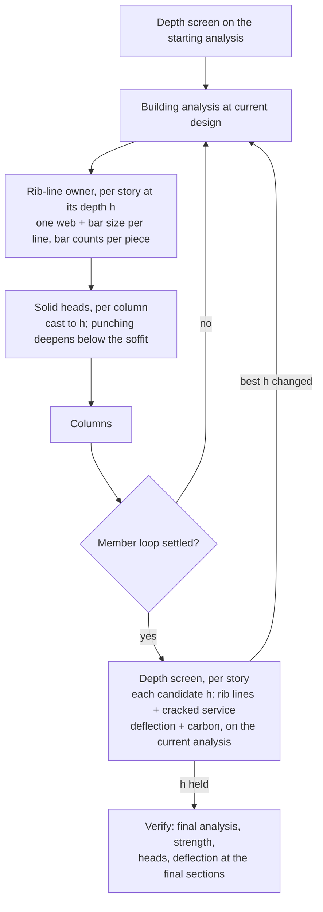

# Ribbed floors: story depth, rib lines, deflection

Status: implemented, 2026-11-19. Applies to waffle (two-way grillage) and one-way
joist floors in `design_building`. Companion to [`architecture.md`](architecture.md):
a ribbed story is the first cluster built in that pattern (one analysis,
a small set of system variables chosen on carbon, then verification).

## 1. Why

Before this change each 30 in rib piece was its own beam group, sized by the
beam MIP for strength only. On `grid/x1y1` (one floor, columns 12 × 10 m,
girders framing 6 × 5 m waffle panels) that meant about 1,600 groups, and
four later passes pulling the pieces back toward something buildable: shared
bars along a line, wider webs for those bars, a depth-step rule, and a
head-face shear raise. Nothing saw the full span, so about 1,400 ribs came
out 11 in deep (5 in topping, 6 in stem), and no rib deflection was checked
(`scale_rib_deflection` existed but had no caller). Shallow ribs then pushed
the hogging and shear onto the solid heads, which grew.

## 2. Decisions (user, 2026-11-19)

| Topic | Decision |
|---|---|
| Rib depth | One overall depth `h` per story, shared by every rib on that story (waffle and joist). Supersedes the piece-by-piece depth in deci-20346596. |
| Rib width | One web width per rib line, so each rib is prismatic end to end. |
| Bars | One bar size per rib line; the count may vary piece by piece where a piece needs more. |
| Depth candidates | Topping plus the existing stem grid (6, 8, 10, 12, 14, 16, 18, 20, 24 in), shared with the joist catalog. Standard 30 in dome depths are an option, not the default. |
| What sets depth | Strength of every rib at that depth, the solid heads, and computed deflection (ACI 318-11 §9.5.3.4: thinner than the Table 9.5(c) minimum is permitted when computed deflections meet Table 9.5(b)). |
| Deflection measure | Peak sag of the floor below the surface through its corner columns (columns deflect too), over `l` = the longer center-to-center column span of that column bay. |
| Long-term limit | A setting. Default l/480 (Table 9.5(b): nonstructural elements likely to be damaged); l/240 selectable. Immediate live load: l/360. |
| Objective | Embodied carbon of concrete plus longitudinal rebar in ribs and solid heads. |

## 3. Pipeline

### 3.1 Story depth variable

`FramingLevel.rib_stem` holds the stem below the topping; every rib is
`hf + rib_stem` deep. Every level on one story gets the same value.
`DesignParameters.rib_stem` fixes it; otherwise the screen picks it from
`rib_stems`. The heads already read the deepest rib on their level
(`_sized_rib_depth`), which is now that depth.

### 3.2 Rib-line owner (replaces per-piece MIP for ribs)

A rib set is the group of sizing groups that share a web and a bar size:

- waffle: a collinear line of rib pieces across the story, from
  `_collinear_rib_groups` (it already walks through girders and head pieces);
- one-way joists: one joist group (interior or edge), as today.

For each set and each candidate web `bw` (4 to 8 in, filtered by ACI 318-11
§8.13.2, stem ≤ 3.5 bw, and §8.13.3, clear spacing ≤ 30 in) and each bar size,
every piece takes the fewest bottom and top bars of that size that pass the
T-beam checker at its own demand (strength, shear with stirrups, §10.5,
§10.3.5, torsion). A combination is feasible when every piece passes. The
set keeps the feasible combination with the least carbon. With no feasible
combination the set is infeasible at this depth, which the depth screen reads.

Neighbor webs for the §8.12.2 flange are taken at their current section, or at
the widest rib web when unsized (conservative), and
`_verify_tbeam_flanges` still checks the assumption.

### 3.3 Solid heads

Unchanged logic, cast to the story depth. Newly cut pieces are re-sized by the
rib-line owner on their whole lines.

### 3.4 Deflection (verification and screen)

Per story, on the building model:

1. Service loads from `_service_dead_live_loads`: dead `D`, sustained
   `S = D + ψL` (ψ is `sustained_live_fraction`), and `D + L`.
2. For each load level, every concrete beam element on the story (ribs and
   girders) gets `Ie` from ACI 318-11 Eq. (9-8) at its own service moment, from
   that level's solve, with `Icr` for the sign of the moment (T-section with
   bottom bars for sagging, web with top bars for hogging; an element takes
   the sign with the larger moment). The first solve is uncracked (`Ig`);
   each element's factor `Ie/I_model` then only ratchets down, until it moves
   less than 5 percent or four passes. A section with no top bars takes those
   the factored solve in the model requires. Solid-head pieces and columns
   keep the model's stiffness. `story_rib_deflection` in
   `rib_deflection.jl`.
3. Sag at each rib station is measured from the surface through the corner
   columns of its column bay: bilinear for a quadrilateral bay, a plane for a
   triangle. Bays are the Delaunay triangles of the story's columns, with
   pairs merged into a quadrilateral across their common longest edge when
   the result is convex.
4. Immediate live `Δ_L = Δ_(D+L) − Δ_D`, limit l/360. Long-term
   `λΔ Δ_S + (Δ_(D+L) − Δ_S)` with Eq. (9-11) λΔ (ξ = 2.0, ρ′ = 0), limit from
   the setting (default l/480).

### 3.5 Depth screen

`screen_rib_stems!` runs before the first member loop (on the starting
analysis) and after each loop. Each story sizes its rib lines at every
candidate stem on the current demands. Among the stems where every set
passes, in order of carbon (ribs, plus head concrete below the topping at the
heads' current area), the first whose cracked deflection passes is chosen.
With none passing deflection the deepest strength-passing stem is kept; with
none passing strength the deepest stem. The member loop runs again after a
stem moves, at most `RIB_SCREEN_ROUNDS = 3` screens. `report_rib_deflection!`
then checks deflection on the final sections and heads. Both go on the
level's `rib_report` (`deflection`, `screen`).

## 4. Passes retired

- `conform_rib_lines!` and `rib_depth_step` (depth is per story; §8.13.2
  holds piece by piece at one stem, so the narrowest piece is covered).
- `raise_head_face_ribs!` (head-face pieces are checked in the owner with
  `stirrup_shear = rib_head_stirrups`).
- Per-piece MIP for ribs and the rib half of `_share_collinear_rib_bars!`
  (non-rib edge T-beams keep it).

## 5. Phases

1. Story depth + rib-line owner + heads at the story depth; retire the passes.
   Tests: owner unit tests (single line, a set that is infeasible at a shallow
   depth, one-sided edge piece), grillage tests updated.
2. Cracked service deflection per story. Tests: a single span rib against
   5wL⁴/384EcIe; a bay whose columns settle shows no sag from that settlement.
3. Depth screen with carbon. Test: a span that fails deflection at the
   shallow depth moves deeper.
4. Report (story depth, deflection, rib-line summary; a beam's ✗ is its own
   check, not member-loop convergence). Rerun `grid/x1y1` dense waffle and a
   joist plan; write the scene.

## 6. Engineering judgment to flag in code

- Bays from the column Delaunay triangulation. Walls are not yet supports in
  the deflection reference; a story with walls is reported as unchecked.
- Solid heads at model stiffness in the service solve.
- The fixed-point iteration on `Ie` (5 percent, four passes).
- Roof live-load limit taken as l/360 (Table 9.5(b) allows l/180 for flat
  roofs not supporting damageable elements); conservative.
- Stirrups and head bars are not in the carbon objective.
- One Ie per element from the sign of its larger service moment.
- Top bars for hogging Ie, when a section has none, from the factored solve.
- Bays cover the convex hull of the column tops; a column inset from an edge
  leaves a thin triangle bay along that edge.
