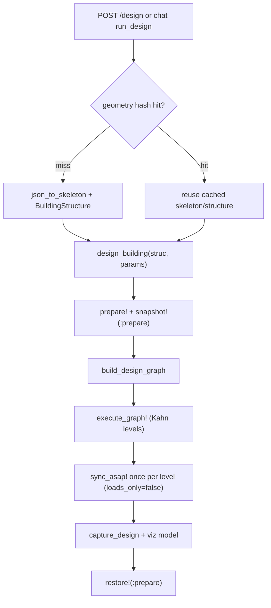

# Iterative Analysis — Architecture & Performance Audit

**Scope:** end-to-end iterative design path — Design Harness / API → `StructuralSynthesizer` → `StructuralSizer` → `Asap`.
**Mode:** static-first. No production code or engineering formulas were changed. Measured validation is specified but deferred to a later phase.
**Date:** 2026-10 · **Status:** review deliverable

---

## 1. Executive summary

The iteration stack is already unusually disciplined for a safety-critical engineering tool: it has an **exact-first culture** (byte-identical equivalence gates), a working **incremental DAG engine** with content-fingerprint invalidation, and a **warm-state / factorization-reuse** layer that is verified bit-identical to the cold path (12/12 checks, see `scripts/runners/verify_warm_state_incremental.jl`). The architecture is sound. The highest-value opportunities are therefore **not** rewrites — they are about *connecting machinery that already exists but is not on the hot path*, and *shrinking the cost of the incremental substrate*.

There are three distinct orchestration layers, and the single most important finding is that **the production API and chat loops run the cold full-design path on every parameter change** and never touch the incremental engine that was built, verified, and exported for exactly this purpose.

**Top opportunities, in priority order:**

1. **Wire the incremental engine into the API/chat iteration loop** (param-only changes) — largest latency win, machinery already verified exact-first.
2. **Shrink the per-node memo** from a whole-`BuildingStructure` `deepcopy` to the composable per-slab/column snapshots that already exist and are unit-tested.
3. **Use `loads_only` / factorization reuse on the cold-path `sync_asap!`** where the stiffness matrix is provably unchanged.
4. **Reduce FEA re-factorization** on load-only flat-plate passes (the FEA load-case path still nulls the factor).
5. **Consolidate duplicated abstractions** — dual pipeline definitions, dual snapshot models, runner/test harness duplication — behind single sources of truth.

Everything in sections 4–5 that changes a solve path must pass the existing exact-first gates **before** any speed claim; several items are explicitly *hypotheses requiring profiling* and are labelled as such.

---

## 2. Current-state architecture

### 2.1 The three orchestration layers

| Layer | Entry point | State model | Used by |
|---|---|---|---|
| **A — Cold full design** | `design_building` → `build_design_graph` → `execute_graph!` ([`design_workflow.jl`](../StructuralSynthesizer/src/design_workflow.jl), [`executor.jl`](../StructuralSynthesizer/src/design_graph/executor.jl)) | `prepare!` + `snapshot!(:prepare)`, mutate caller `struc`, `restore!` at end | **POST /design, chat `run_design`** (production default) |
| **B — Incremental DAG** | `DesignSession` / `run_target!` / `redesign_incremental!` ([`scheduler.jl`](../StructuralSynthesizer/src/design_graph/scheduler.jl), [`session.jl`](../StructuralSynthesizer/src/design_graph/session.jl)) | Fixed prepared baseline + per-node whole-`struc` memo + content fingerprints | **Verify harnesses and library callers only — not the API** |
| **C — Micro-experiments** | `evaluate_experiment` ([`micro_experiments.jl`](../StructuralSynthesizer/src/api/micro_experiments.jl)) | Cached `BuildingDesign`, no `struc` mutation | Agent "instant" what-if checks |

A fourth, read-only layer — **DesignState** ([`design_state.jl`](../StructuralSynthesizer/src/api/design_state.jl)) — projects a design to a serializable/hashable form for the harness and does no recompute.

### 2.2 Cold path (what the API actually runs today)

The geometry cache ([`cache.jl`](../StructuralSynthesizer/src/api/cache.jl)) keys only on geometry (`compute_geometry_hash` deliberately excludes params), so a parameter-only change is a **cache "hit" that still pays the full `prepare!` + entire pipeline + per-level `sync_asap!`**. The incremental engine is the thing designed to avoid that, and it is not called here (`routes.jl` L648, `chat.jl` L4543 both call `design_building`).

### 2.3 Incremental path (built and verified, idle in production)

`run_target!` ([`scheduler.jl`](../StructuralSynthesizer/src/design_graph/scheduler.jl)) walks the graph in Kahn levels, classifies each node clean/dirty by an `input_hash` derived from upstream `output_hash`es + the node's param slice + a baseline geometry fingerprint, recomputes only dirty nodes, restores clean nodes from a per-node snapshot, and flushes `sync_asap!` once per level that contains a recomputed `needs_sync` node. Invalidation is content-based and conservative; a `dirty_frontier` can be computed without executing anything (used by the equivalence tests).

Correctness is fenced aggressively: a `PREPARE_AFFECTING_FIELDS` guard forces a new engine when a prepare-affecting parameter changes; a partial-slab-target guard makes the "mixed clean/dirty slab level" state *unrepresentable* because shared columns grow monotonically and order-dependently.

### 2.4 Synchronization barrier

Both the cold executor and the incremental scheduler share one abstraction: run a whole topological level, then call `sync_asap!` **once** if any recomputed node in the level declares `needs_sync`. For the current coarse linear chain every level holds one node, so this is byte-identical to the legacy per-stage loop; the barrier exists so a future multi-node slab level syncs the model once rather than per node.

### 2.5 Code-graph health context

`codebase(action="health")` grades the repo **F**, but the drivers are almost entirely **outside the iterative Julia core**: C# god-objects and churn in `grasshopper/Menegroth.GH/**` (including committed `obj/`/`bin/` build artifacts), plus coverage degradation from 33 indexed-but-untracked test files and 8 missing build-artifact files. Within the audited path the real structural signals are **high fan-out and import cycles**, not god-objects:

- Coupling hotspots: `external/Asap/src/Asap.jl` (35 imports), `StructuralSizer/.../flat_plate/analysis/_fea.jl` (20), `StructuralSynthesizer/src/api/_api.jl` (19).
- Import/call cycles: `materials/{concrete,frc,types}.jl`; `waffle/{rib_layout,wachspress}.jl`; `flat_plate/analysis/{common,ddm,efm}.jl` + `utils/helpers.jl`; `api/{diagnose,report_summary}.jl`; `api/{chat,narrate,routes}.jl`.
- Churn hotspots (stabilize interface + regression tests): `api/chat.jl` (42 commits/400), `api/agent_tools.jl` (26), `api/tool_registry.jl` (25).

---

## 3. How to read the findings

Each finding carries **Evidence** (verified in source) vs **Hypothesis** (needs profiling), an **Impact** and **Confidence**, and a **Safety** note. Under `code-accuracy.mdc` / `corpus.mdc`, *no finding proposes changing a formula, factor, unit, or applicability condition*. Every behavior-affecting change is gated on the exact-first harnesses in section 6.

Priority key: **P0** = highest leverage, **P3** = lowest. Impact/Confidence/Effort are H/M/L.

---

## 4. Ranked findings — optimization & speed

### P0-1 · API/chat iteration bypasses the incremental engine
- **Type:** Evidence. `routes.jl` L648 and `chat.jl` L4543 both call `design_building`; the geometry cache reuses only skeleton/structure (`cache.jl`); `run_target!`/`DesignSession` are never invoked from `api/`.
- **Impact:** H · **Confidence:** H · **Effort:** M
- **What:** For a param-only change on fixed geometry, the server re-runs `prepare!` + the whole graph instead of `redesign_incremental!` on a cached `DesignSession`.
- **Recommendation:** Hold a `DesignSession` per `geometry_hash` in `DESIGN_CACHE`. On POST /design or chat `run_design`, if `requires_new_engine(session, params)` is false, route through `redesign_incremental!`; otherwise rebuild the engine. The dirty-frontier and prepare-affecting guards already make this safe to gate on.
- **Safety:** The incremental path is already verified bit-identical (`verify_incremental_engine.jl`, `verify_design_graph_incremental.jl`). Keep cold `design_building` as the fallback and the equivalence reference.

### P0-2 · Per-node memo is a whole-`BuildingStructure` deepcopy
- **Type:** Evidence. `NodeMemo.state::BuildingStructure`; `capture_node_state` = `deepcopy` (nulling only the CHOLMOD factor + `_elemental_loads`); `restore_node_state` = `deepcopy` ([`core/snapshot.jl`](../StructuralSynthesizer/src/core/snapshot.jl)).
- **Impact:** H (memory + CPU, scales with slabs × reruns) · **Confidence:** H · **Effort:** M–H
- **What:** Every recomputed node snapshots the entire structure; every all-clean level restore is *another* full `deepcopy`.
- **Recommendation:** Replace the whole-struc memo with the **composable snapshots that already exist and are unit-tested**: slab-owned fields + monotonic shared-column max-state (`restore_slab_node_writes!` / `_adopt_larger_column!`) plus a lazily rebuilt Asap model (the barrier sync already rebuilds it). This is the documented Run-3 direction; the helpers are covered by the "partial per-slab restore" testset but unreachable on the current hot path.
- **Safety:** Must preserve byte-identity; the merge invariants (disjoint per-slab writes, monotonic column growth) are already proven for the overlay helpers.

### P1-3 · Cold-path `sync_asap!` always refactorizes (`loads_only=false`)
- **Type:** Evidence. `execute_graph!` calls `sync_asap!(struc; params=params)` with the default `loads_only=false` ([`executor.jl`](../StructuralSynthesizer/src/design_graph/executor.jl) L45); the `loads_only=true` branch exists and is documented bit-identical but is used "only on provably loads-only variations" ([`analyze/asap/utils.jl`](../StructuralSynthesizer/src/analyze/asap/utils.jl) L550–564, L617–623).
- **Impact:** H on multi-story models (large nDOF, many tributary loads) · **Confidence:** H (mechanism) / M (share of total) · **Effort:** M
- **What:** A full `Asap.update!` rebuilds element K and global `S`, nulls the cached CHOLMOD factor, then the solve refactorizes — on *every* post-level sync, including syncs that only changed load magnitudes.
- **Recommendation:** Classify each sync trigger (loads-only vs section/geometry/eccentricity change) from the recomputed nodes' declared `writes` and `output_hash` equality on `:columns`/`:beams`; pass `loads_only=true` when K is provably unchanged. The scheduler already has the provenance to decide this.
- **Safety:** Misuse with a changed K yields a stale-factor wrong answer. Gate strictly on write-set provenance; the reuse is deterministic and bit-identical when K is truly unchanged.

### P1-4 · FEA load-case path refactorizes when only loads change
- **Type:** Hypothesis (mechanism is Evidence; magnitude needs profiling). `_solve_load_case!` uses `Asap.update!(; values_only=true)` which nulls the factorization and rescatters `S`, unlike `_solve_per_cell_live!` which reuses `Asap._get_factorization` and only back-substitutes (`StructuralSizer/.../flat_plate/analysis/fea/load_cases.jl`).
- **Impact:** H inside FEA flat-plate buildings · **Confidence:** H (mechanism) / M (magnitude) · **Effort:** M
- **What:** For a fixed thickness/sections, each D/L solve pays a full factorization instead of reusing one.
- **Recommendation:** For fixed K, reuse the factor (multi-RHS `solve` or manual `fact \ P`) as the per-cell-live path already does.
- **Safety:** Prove bit-identical displacements/moments on one slab before adopting. Wrong moments → wrong reinforcement.

### P1-5 · FEA flat-plate: D/L split × pattern loading × combo envelope is multiplicative
- **Type:** Hypothesis. `run_moment_analysis(::FEA, …)` → `_solve_dl_cases!`, `_solve_per_cell_live!`, `_fea_pattern_envelope!` (`StructuralSizer/.../flat_plate/analysis/fea/`).
- **Impact:** Very H on FEA flat-plate with `pattern_mode == :fea_resolve` · **Confidence:** H (structure) / needs magnitude · **Effort:** M–H
- **What:** Per thickness iteration ≈ `(2–3 factorizations + n_cells back-subs + n_elements × n_combos × extractors)`.
- **Recommendation:** combine with P1-4; cache the combo tensor per `(k,i)` within an iteration; consider a documented "pattern-off fast screen" for early thickness trials *only if* an exact final pass confirms.
- **Safety:** Any envelope/extractor change must match the FEA integration tests exactly.

### P2-6 · Per-iteration column MIP rebuilds model + screens whole catalog
- **Type:** Hypothesis. `size_flat_plate!` loop → `size_columns` → `optimize_discrete` builds a fresh `JuMP.Model` and runs O(groups × |catalog|) feasibility screening each iteration ([`optimize/solvers/discrete_mip.jl`](../StructuralSizer/src/optimize/solvers/discrete_mip.jl)). P-M diagrams are already hoisted once via `_col_cache`.
- **Impact:** M–H with large `:all` catalogs · **Confidence:** H (work) / M (share) · **Effort:** M
- **Recommendation:** thread `mip_start` from the previous iteration's section indices (already supported); memoize feasible sets when `(Pu, Mu, geometry)` is unchanged; hoist the catalog vector out of the slab loop.
- **Safety:** `mip_start` is a hint and must not change the optimum — already documented; still verify selected sections are unchanged.

### P2-7 · `member_group_demands` samples 200 stations × patterns per sizing call
- **Type:** Hypothesis. `ElementForceAndDisplacement(...; resolution=200)` per segment, per pattern, inside the `_size_beams_columns!` convergence loop ([`analyze/members/utils.jl`](../StructuralSynthesizer/src/analyze/members/utils.jl)).
- **Impact:** M–H for beam+column floors with pattern loading · **Confidence:** M · **Effort:** M
- **Recommendation:** evaluate the envelope at critical stations (ends + max-moment) for sizing, reuse workspaces. **This borders on an engineering-judgment change** (station resolution affects the demand envelope) — treat as ENGINEERING JUDGMENT, validate section choices against `resolution=400`, and do not ship without sign-off.

### P2-8 · `_col_cache` rebuilt per slab on the cold path
- **Type:** Evidence. `_make_slab_node_fn` passes `_col_cache=nothing` ([`design_workflow.jl`](../StructuralSynthesizer/src/design_workflow.jl) L503); the warm path reuses one shared read-only cache via `WarmContext` / `warm_memo`.
- **Impact:** M (first slab / large catalogs) · **Confidence:** H · **Effort:** L (opt-in warm already exists)
- **Recommendation:** default `warm=true` for `DesignSession` sweeps after the first run; consider a `struc`-scoped catalog+cache keyed by `(catalog_id, fc, fy, objective)`.
- **Safety:** Result-neutral — cache is read-only after `precompute_capacities!` (proven by `verify_design_graph.jl`).

### P3-9 · Graph rebuilt on every `run_target!`; viz model built twice on API fallback
- **Type:** Evidence. `run_target!` calls `build_design_graph(engine.baseline, params)` each call ([`scheduler.jl`](../StructuralSynthesizer/src/design_graph/scheduler.jl) L351); `routes.jl` L653 rebuilds the viz model as a fallback if `design_building`'s internal build was skipped.
- **Impact:** L–M · **Confidence:** M · **Effort:** L
- **Recommendation:** cache the graph when only non-topological params change; make the viz-model responsibility single-owner.

### P3-10 · Parametric studies create a full model every option
- **Type:** Evidence. `prepare!` always calls `to_asap!` (full node/element/tributary/shell build). `compare_designs` / API sweeps pay it per option.
- **Impact:** M for sweeps · **Confidence:** H (cost) / M (share) · **Effort:** M — subsumed by P0-1/P0-2 (sessions + cheaper snapshots).

---

## 5. Ranked findings — consolidation & architecture

### C1 · Single production orchestrator facade
Collapse "cold vs incremental vs micro" selection behind one entry: `design_building(struc, params; mode=:auto, session=nothing)` (or an API-held `DesignSession` per geometry). `:auto` routes param-only changes to `redesign_incremental!` and prepare-affecting changes to a fresh engine. Directly enables P0-1.

### C2 · Unify the two snapshot models
There are two parallel snapshot systems: `snapshot!`/`restore!` with `DesignSnapshot` (design-mutable fields, for cold parametric `restore!`) and `capture_node_state`/`restore_node_state` (whole-struc deepcopy, for the incremental memo), both in overlapping files ([`core/snapshot.jl`](../StructuralSynthesizer/src/core/snapshot.jl), [`building_types/snapshot.jl`](../StructuralSynthesizer/src/building_types/snapshot.jl)). Converge on one layered model (design-state overlay + lazy Asap rebuild). Directly enables P0-2.

### C3 · Single source of truth for the pipeline
`build_pipeline` (stage closures) and `build_design_graph` (graph wrapping the same closures) are defined separately with a defensive stage-count guard (`design_workflow.jl` L353). Generate one from the other (or register graph nodes directly from the pipeline spec in `provenance.jl`) so they cannot drift. The guard is a symptom of the duplication.

### C4 · Break import cycles / narrow fan-out
Address the cycles and high-fan-out facades from section 2.5 (flat-plate analysis `common/ddm/efm`, api `chat/narrate/routes`, Asap's 35-import root). These raise recompile/precompile cost and make the churny API surface fragile. Favor extracting a thin facade over the FEA analysis cluster.

### C5 · Runner / harness consolidation
~196 files under `scripts/runners/`. Verify runners and their in-suite twins duplicate `_INVARIANT_COLS` / `design_signature` / building builders; the speedup runner inlines study helpers to dodge a second `Asap` module identity. Extract **one** shared fixtures/invariants module included by both runners and tests; namespace runners into `gates/`, `studies/`, `bench/` with a `run_all_gates.jl` manifest.

### C6 · Separate build artifacts from source index
Commit `grasshopper/**/obj/` and `bin/` are inflating churn and degrading code-graph coverage. Gitignore build outputs and track the 33 untracked test files so `codebase` answers stop being silently incomplete.

---

## 6. Development best practices (this codebase)

1. **Exact-first is the contract.** Any change to `build_design_graph`, `execute_graph!`, `run_target!`, `sync_asap!`, a snapshot path, or a solve path must pass, in order: `verify_design_graph.jl` → `verify_incremental_engine.jl` → `verify_design_graph_incremental.jl` → `verify_warm_state_incremental.jl` (+ the in-suite `test/design_graph/` twins). No speed claim before green.
2. **Never gate on runtime without correctness on the same commit.** Runtime rows are trend data, not a pass/fail on their own.
3. **Bump `code_version` in `provenance.jl`** whenever a node closure's semantics change — this is how the memo invalidates safely.
4. **Separate code-derived from judgment.** Under `code-accuracy.mdc`, resolution/envelope/screening changes that touch the demand or capacity path are ENGINEERING JUDGMENT; comment them as such, cite the clause for anything code-derived, and get sign-off.
5. **Prefer `DesignSession` + `redesign`/`vary` for fixed-geometry sweeps**; use `dirty_frontier(session; overrides...)` to assert expected invalidation before a sweep.
6. **Keep prepare-affecting changes on the new-engine path** (`PREPARE_AFFECTING_FIELDS`); never try to retrofit `:pattern_loading` through a sync.
7. **Route every new entry point through the `member_group_overrides` guard** (`_assert_member_group_overrides_unsupported`).
8. **Pin `external/Asap`** before regenerating any performance baseline; treat a dirty submodule as baseline-invalidating.
9. **Headless env on all automated runs** (`SS_ENABLE_VISUALIZATION=false`, `SS_ENABLE_HEAVY_PRECOMPILE_WORKLOAD=false`).
10. **Profile before optimizing a solve.** Add temporary `@time`/`@allocated`/factorization counters on a branch; do not commit speculative solve changes.

---

## 7. Static-first measurement design (deferred execution)

### 7.1 Current measurement assets
- **Exact-first gates:** `verify_design_graph.jl`, `verify_incremental_engine.jl`, `verify_design_graph_incremental.jl`, `verify_warm_state_incremental.jl`, plus `test/design_graph/test_design_graph_{equivalence,incremental,topology}.jl`.
- **Perf harness:** `run_flat_plate_speedup_validation.jl` (output-frozen invariant diff vs committed baseline; records `runtime_s` but does **not** fail on runtime); `benchmark_fea.jl` (phase-level `@elapsed`).
- **Gaps:** no `BenchmarkTools`/`Profile`/`TimerOutputs` in sources; no CI performance gate; no run-ledger wiring; fixtures narrow (medium-office 2×2 repeated).

### 7.2 Proposed benchmark matrix (to run in the measured phase)

| Scenario | Primary probes |
|---|---|
| Medium office · FEA flat plate · `:fea_resolve` | `size_flat_plate!` profile; factorization count; iterations to converge |
| Same · DDM/EFM | total `design_building` vs FEA |
| Steel beams + columns · patterns on | `member_group_demands` + `optimize_discrete` + `sync_asap!` split |
| 5× `design_building` on one skeleton | `prepare!` vs pipeline; cold vs warm incremental |
| Large RC `:all` catalog · discrete columns | `precompute_capacities!` vs MIP |
| Param-only rerun (cold vs incremental) | end-to-end latency + recomputed/restored node counts + `design_signature` equality |

### 7.3 Instrumentation schema (low-risk, additive)
Extend `phase_timings` / `TraceCollector` with: `recomputed_nodes`, `restored_nodes`, `memo_bytes`, `sync_count`, `factorization_count`, `sync_seconds`, peak RSS, and the solver setup/solve split. Surface in `BuildingDesign.phase_timings` for session runs.

### 7.4 Reproducibility / run-ledger
Record each sweep or gate run via `angelo ledger record` / `dataset(action="register_run")` with roles — params (`method`, span, catalog), metrics (`runtime_s`, invariant hashes, `memo_bytes`), context (`gate=…`, `study=…`) — and attach env fingerprint: root + `external/Asap` SHA, Julia version, `SS_ENABLE_*`, solver backend (Gurobi vs HiGHS). Pre-register any ≥5% speedup claim as a `memory-artifacts` experiment with pass criteria.

### 7.5 Tiered gate model
- **Tier A (exact-first, mandatory before any perf claim):** the four verify runners + speedup invariant diff.
- **Tier B (package tests):** `design_graph` block in `runtests.jl`.
- **Tier C (performance, informational → soft gate):** record `runtime_s` + env fingerprint; fail only on >X% regression *with Tier A green on the same commit*; never fold the 8-minute warm-state gate into every PR unsharded.

---

## 8. Phased roadmap

```mermaid
flowchart LR
  subgraph p0 [Phase 0 - static, no long runs]
    A1["Gate + fixture inventory"]
    A2["Invariant/signature schema doc"]
    A3["Duplication + CI-gap report"]
    A4["Gitignore build artifacts; track test files"]
  end
  subgraph p1 [Phase 1 - measure]
    B1["Add timing/factorization/memo instrumentation"]
    B2["Benchmark matrix + baselines + env fingerprint"]
    B3["Run-ledger wiring on sweep outputs"]
  end
  subgraph p2 [Phase 2 - safe wins, gated]
    C1g["Wire incremental engine into API/chat (P0-1)"]
    C2g["Shrink per-node memo (P0-2)"]
    C3g["loads_only on cold sync + FEA factor reuse (P1-3/4)"]
  end
  subgraph p3 [Phase 3 - consolidation]
    D1["Orchestrator facade + unified snapshots"]
    D2["Single pipeline SSoT; break cycles; runner consolidation"]
  end
  p0 --> p1 --> p2 --> p3
```

Each Phase-2/3 item is behind the Tier-A gates and, where it touches demand/capacity, an ENGINEERING-JUDGMENT sign-off.

---

## 9. Evidence index (verified in source)

- Cold path entry: `StructuralSynthesizer/src/api/routes.jl` L648; `chat.jl` L4543; geometry-only cache `api/cache.jl` (`compute_geometry_hash`, `is_geometry_cached`).
- Barrier executor: `StructuralSynthesizer/src/design_graph/executor.jl` (`execute_graph!`, default `loads_only=false`).
- `sync_asap!` + `loads_only`: `StructuralSynthesizer/src/analyze/asap/utils.jl` L550–644.
- Incremental scheduler + guards: `StructuralSynthesizer/src/design_graph/scheduler.jl` (`run_target!`, `PREPARE_AFFECTING_FIELDS`, partial-slab guard, `warm_memo`).
- Whole-struc memo: `StructuralSynthesizer/src/core/snapshot.jl` (`NodeMemo`, `capture_node_state`, `restore_node_state`, `restore_slab_node_writes!`, `_adopt_larger_column!`).
- Dual pipeline: `StructuralSynthesizer/src/design_workflow.jl` (`build_pipeline` L214, `build_design_graph` L348, stage-count guard L353, `_make_slab_node_fn` `_col_cache=nothing` L503).
- Code-graph health: `codebase(action="health")` — grade F driven by `grasshopper/**`; core signals = coupling/cycles in FEA + api clusters.

*No formulas, factors, units, or applicability conditions were modified in producing this audit.*
